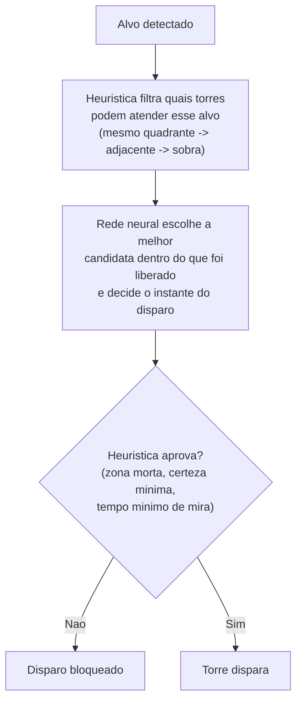
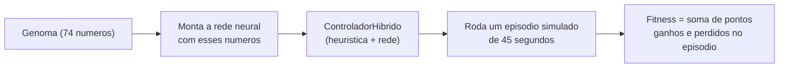
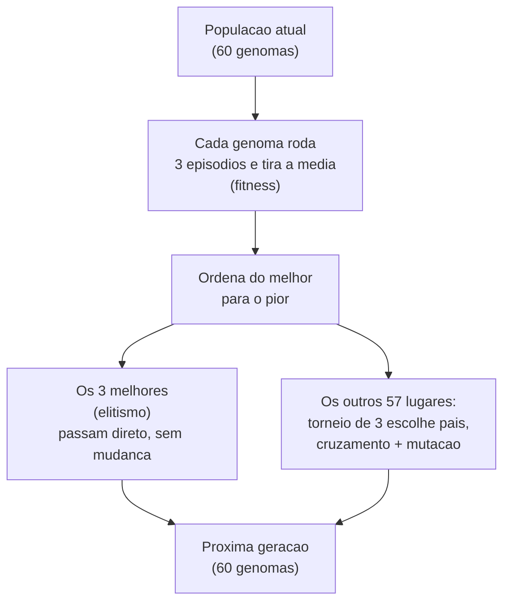
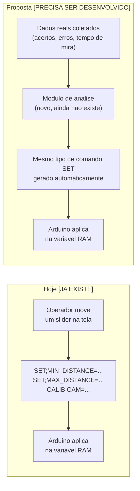

# Como a IA funciona no RadarTorres

Este documento explica, em linguagem acessível, como funciona o controlador "inteligente" das
torres do RadarTorres: o que é heurística, o que é rede neural, como as duas se combinam, o que é
"fitness" (pontuação de treino), como o sistema ganha e perde pontos, se existe um teto/piso de
pontuação, se genomas são descartados, e se é possível chegar a um controlador "perfeito".

Todas as informações aqui vêm diretamente do código-fonte do projeto
(`src/RadarTorres.App/NeuralEvolution/`), não de suposição.

---

## 1. Visão geral: duas peças, não uma só

Quando as pessoas ouvem "IA", costumam imaginar só a rede neural. No RadarTorres a decisão de qual
torre atira em qual alvo, e quando atirar, nunca é tomada só pela rede neural — ela é sempre tomada
por **duas peças trabalhando juntas**, dentro da mesma classe (`ControladorHibrido`):

1. **Heurística** — um conjunto de regras fixas, escritas à mão, que nunca mudam sozinhas.
2. **Rede neural** — um "ajuste fino" aprendido por treino evolutivo (explicado abaixo), que decide
   dentro do espaço que a heurística já liberou.



A ideia central: a rede neural **nunca decide sozinha**. Ela só ajusta a decisão dentro de um
espaço que a heurística já considerou seguro. Se a rede "pedir" algo fora desse espaço (atirar numa
zona morta, atirar sem certeza suficiente, escolher uma torre ocupada), a heurística barra. No pior
caso, o sistema volta a se comportar como a heurística pura — nunca faz algo arbitrário.

---

## 2. O que é a heurística (a parte "regra fixa")

A heurística decide em cascata, por camadas de prioridade, qual torre pode atender um alvo:

1. Primeiro, olha só as torres livres do **mesmo quadrante** do alvo.
2. Se nenhuma estiver livre, olha torres de **quadrante vizinho**.
3. Se nenhuma das anteriores, usa **qualquer torre livre restante** — nenhum alvo fica sem
   cobertura.

Depois disso, ela ainda aplica regras de segurança que a rede nunca pode desrespeitar:

- **Tempo mínimo de mira**: a torre precisa ficar pelo menos 0,3 segundo "olhando" pro alvo antes
  de poder disparar.
- **Certeza mínima de identificação**: o disparo só é liberado se a certeza de que aquilo é
  realmente um alvo for de pelo menos 70% (padrão; configurável, nunca abaixo de 40%).
- **Zona morta**: quadrantes marcados como zona morta nunca recebem disparo, não importa o que a
  rede "ache".

## 3. O que é a rede neural (a parte "aprendida")

É uma rede neural pequena, criada do zero no código (sem biblioteca de IA pronta):

- **6 entradas**: distância normalizada até o alvo, se é do mesmo quadrante, se é de quadrante
  vizinho, ângulo de mira, velocidade do alvo, e a camada heurística vigente.
- **1 camada escondida de 8 neurônios.**
- **2 saídas**: um ajuste de pontuação (para desempatar entre torres candidatas) e uma confiança de
  disparo (decide o instante exato de atirar).
- Ao todo, **74 números** (pesos + vieses) definem completamente essa rede.

Diferente da maioria das IAs que você já deve ter ouvido falar (que aprendem por
"retropropagação"/gradiente), essa rede **não aprende sozinha observando erros em tempo real**. Os
74 números dela são decididos por um **algoritmo genético** — é aí que entram fitness, pontuação,
gerações e genomas.

---

## 4. O que é "fitness"

**Fitness é a pontuação de um episódio simulado de treino.** Cada "genoma" (um conjunto de 74
números/pesos para a rede) é testado controlando as torres durante um episódio simulado de
**45 segundos**, com alvos nascendo na borda de um círculo de 10 metros de raio e avançando em
direção à base. O fitness é simplesmente a soma de pontos ganhos e perdidos ao longo desse episódio.



Importante: **cada genoma é testado em 3 episódios diferentes (sorteados de formas diferentes) e o
fitness final é a média dos 3**. Isso existe porque um único episódio é "barulhento" demais — o
mesmo genoma podia cair num cenário fácil ou difícil só por sorte, o que faria o algoritmo genético
escolher por sorte, não por mérito.

---

## 5. Como o sistema ganha pontos

Só existe uma forma de ganhar pontos: **abater um alvo antes que ele chegue na base.**

```
pontos_ganhos = 10 × (0,7 + 0,3 × bonus_distancia)
```

Onde `bonus_distancia` é o quão longe da base o alvo estava quando foi abatido (0 = bem em cima da
base, 1 = na borda do mundo, a 10 metros). Ou seja:

- Abater um alvo **bem longe da base** vale **10 pontos** (o máximo por abate).
- Abater um alvo **bem perto da base** vale **7 pontos** (o mínimo por abate que ainda conta como
  sucesso).

Isso existe de propósito: recompensar abater cedo (sobra mais margem de erro) mais do que abater em
cima da hora.

## 6. Como o sistema perde pontos

Existem duas formas de perder pontos, e elas são diferentes:

| Situação | Quando acontece | Quanto perde |
|---|---|---|
| **Alvo chegou perto demais da base** (aviso) | Alvo cruza 0,5 m de distância da base, mesmo sem ter "escapado" de verdade ainda | **−3 pontos**, uma única vez por alvo |
| **Alvo escapou de verdade** | Alvo cruza 0,4 m de distância da base (bem em cima dela) sem ter sido abatido | **−8 pontos**, e a torre que estava de olho nele é liberada |

Repare que os dois podem acontecer com o **mesmo alvo**: primeiro ele cruza os 0,5 m (−3), e só
depois, se continuar sem ser abatido, cruza os 0,4 m e escapa de vez (−8) — nesse caso o alvo
custou **−11 pontos** sozinho. Por isso vale mais a pena abater cedo.

Há também um terceiro evento que **não tira pontos diretamente, mas também não dá pontos**: o
**tiro errado**. Mesmo quando a torre está autorizada a atirar, existe uma chance de errar,
crescente com a velocidade do alvo:

```
chance_de_erro = 1 − e^(−0,35 × velocidade)
```

Na prática: alvo parado ≈ 0% de chance de errar; alvo a 1 m/s ≈ 30%; alvo na velocidade máxima
simulada (2,5 m/s) ≈ 59%. Um tiro errado não soma nem subtrai pontos diretamente, mas "desperdiça"
a chance de ganhar os 7–10 pontos daquele abate — então, indiretamente, empurra o genoma a não
deixar o alvo chegar rápido demais sem reação.

---

## 7. Existe uma pontuação máxima ou mínima?

**Não existe um teto nem um piso fixos — o fitness é uma soma aberta, não uma nota de 0 a 100.**

Isso é diferente de provas escolares ou de jogos com pontuação limitada. Aqui, quanto mais alvos
nascerem e forem abatidos num episódio de 45 segundos, mais alto o fitness pode subir; quanto mais
alvos escaparem, mais fundo ele pode cair. Não existe um valor "perfeito" documentado no código.

Para dar uma noção de escala (não são limites oficiais, são só contas aproximadas a partir das
regras acima):

- Em 45 segundos, com alvos nascendo a cada 1,5–4 segundos, **cabem entre ~11 e ~30 alvos** no
  episódio (limitado a no máximo 5 "vivos" ao mesmo tempo).
- Um episódio **muito bom** (quase todos abatidos longe da base) poderia somar algo perto de
  **+200 a +300 pontos**.
- Um episódio **muito ruim** (quase todos escapando) poderia ficar perto de **−200 a −300 pontos**.

Esses números são só para dar intuição de grandeza — o que importa de verdade é a **comparação
relativa** entre genomas dentro da mesma geração (todos enfrentam os mesmos 3 cenários sorteados),
não um valor absoluto de referência.

---

## 8. Existe descarte de genoma?

**Sim, mas não é um descarte explícito tipo "lista negra" — é seleção natural por geração.**

A cada geração, a população tem sempre **60 genomas**. O que acontece:



- Os **3 melhores genomas** (elitismo) são copiados sem alteração para a próxima geração — isso
  garante que a geração **nunca piora** em relação à anterior.
- Os outros **57 lugares** são preenchidos por filhos: dois "pais" são escolhidos por **torneio de
  3** (sorteiam-se 3 genomas da população, vence o de maior fitness entre os 3), seus genes são
  misturados (**cada um dos 74 números vem do pai ou da mãe, 50% de chance cada**), e depois cada
  gene tem **8% de chance** de sofrer uma pequena mutação aleatória.
- Genomas ruins não são explicitamente apagados ou proibidos — eles simplesmente **têm muito menos
  chance de vencer um torneio e virar pai**, então, geração após geração, as características deles
  tendem a desaparecer da população. É assim que a evolução "descarta" o que não funciona: por
  baixa probabilidade de reprodução, não por exclusão manual.
- A população inteira é **recriada a cada geração** (exceto os 3 elites) — não existe um "arquivo"
  guardando todo genoma já testado. O que fica salvo no banco de dados são só resumos periódicos: o
  fitness médio/melhor a cada bloco de gerações, e um "retrato" do melhor genoma de cada marco
  (contagem de abates, fugas, tiros errados e o próprio genoma em texto).

---

## 9. É possível chegar a um sistema "ideal"?

**Não, e isso é esperado — por três motivos, todos de projeto, não falha:**

1. **O ambiente é sorteado, não fixo.** Onde o alvo nasce, sua velocidade, a rapidez com que a
   certeza dele sobe, tudo isso é sorteado a cada alvo. Mesmo o "melhor genoma possível" vai, às
   vezes, pegar um cenário difícil (alvo rápido, nascendo perto) e vai perder pontos nele —
   não por erro do genoma, por azar do cenário.
2. **O erro de disparo é probabilístico.** Mesmo um disparo perfeitamente autorizado, no momento
   certo, pode errar — a chance cresce com a velocidade do alvo e nunca chega a 0%. Não existe
   genoma que acerte 100% dos disparos contra alvos rápidos; a própria regra do jogo (a mesma usada
   em produção) impede isso.
3. **Algoritmo genético não garante "o melhor de todos os mundos".** Diferente de um problema de
   matemática com resposta única, o algoritmo genético só garante **melhora ao longo do tempo**
   (por causa do elitismo) — ele pode ficar "preso" numa solução boa, mas não a melhor
   teoricamente possível (isso se chama **ótimo local**, bem documentado na literatura de
   algoritmos genéticos). Rodar mais gerações tende a melhorar, mas não existe garantia matemática
   de chegar ao máximo absoluto.

Além disso, vale lembrar o ponto da seção 1: a rede neural só ajusta dentro do que a heurística já
permite. Então o "teto" de qualidade do sistema também depende da própria heurística ser boa — se
ela tiver uma regra ruim, a rede não consegue compensar isso sozinha, só otimizar dentro da regra
que existe.

**Na prática**, o que o treinamento faz é: convergir, geração após geração, para um comportamento
cada vez melhor e mais consistente diante da variação do ambiente — não para um valor fixo de
"sistema perfeito", mas para um platô de bom desempenho, com melhora cada vez mais lenta conforme
mais gerações passam (comportamento típico de algoritmos evolutivos).

---

# Parte 2 — Como a IA poderia ajustar variáveis do Arduino durante a execução (PROPOSTA)

**Aviso importante antes de começar**: tudo que vem a partir daqui, até a seção 17, é uma
**proposta de arquitetura — nada disso está implementado hoje**. A Parte 1 deste documento (seções
1 a 9) descreve um mecanismo que já existe e já roda no projeto: o treino evolutivo da rede neural
do `ControladorHibrido`. Essa parte 2 descreve um mecanismo **diferente e ainda não construído**:
o controlador desktop observando o comportamento real do sistema em operação e ajustando, por
comando serial, variáveis de controle que hoje moram fisicamente no firmware do Arduino — sem
jamais reescrever ou regravar esse firmware. Cada afirmação abaixo está marcada como
**[JÁ EXISTE]**, **[PRECISA SER DESENVOLVIDO]** ou **[PROPOSTA/OPÇÃO]**, para não deixar dúvida
sobre o que já roda no projeto e o que é desenho de solução.

## 10. Duas coisas diferentes usam a palavra "IA" neste projeto — não confundir

A Parte 1 inteira trata de um processo **offline**: o algoritmo genético roda numa tela de
treinamento, dentro de episódios **simulados**, e o resultado — um genoma de 74 números — é
embutido no instalador do aplicativo (`genoma-controlador.json`) antes mesmo de o sistema ser
ligado em campo. Esse genoma não é enviado ao Arduino, não é uma "variável de controle", e não
muda sozinho durante a execução real — ele só muda quando alguém treina uma geração nova e embute
o resultado manualmente.

O que esta Parte 2 descreve é outra coisa: um mecanismo **online**, rodando durante a operação
real do sistema (não em simulação), que observaria dados coletados de verdade (acertos, erros,
tempo de travamento de mira etc.) e, a partir deles, ajustaria **parâmetros do firmware do
Arduino** — não os 74 pesos da rede neural, que continuam vivendo inteiramente no app desktop e
nunca saem de lá. São dois sistemas de ajuste completamente distintos, usando duas palavras
diferentes para "IA" que merecem não ser misturadas:

| | Parte 1 — treino evolutivo (**JÁ EXISTE**) | Parte 2 — ajuste de variáveis do Arduino (**PROPOSTA**) |
|---|---|---|
| O que muda | Os 74 pesos da rede neural do `ControladorHibrido` | Parâmetros numéricos do firmware (ex.: tolerância de mira, nº de leituras estáveis) |
| Onde roda o ajuste | Só no app desktop, offline, em simulação | App desktop observando dados reais + Arduino aplicando o valor |
| Quando acontece | Antes de o sistema entrar em operação (treino manual) | Durante a operação real, continuamente |
| Onde o resultado vive | Embutido no app (`genoma-controlador.json`) | Em variáveis na memória RAM do Arduino (ou EEPROM, se implementado) |
| Risco de piorar o sistema físico real | Nenhum — testado só em simulação antes de embutir | Direto — qualquer ajuste ruim afeta o hardware físico imediatamente |

## 11. O que já existe hoje na comunicação com o Arduino

Antes de propor qualquer coisa nova, veja o que o protocolo serial do RadarTorres já é capaz de
fazer hoje — documentado em `Docs/Tecnica/COMUNICACAO_ARDUINO.md` e implementado em
`src/RadarTorres.App/Services/SerialProtocolParser.cs`.

**[JÁ EXISTE]** Mensagens Arduino → PC: `TARGET;ID=;ANGLE=;DIST=` (leitura de alvo),
`STATUS;SYSTEM=` (estado do sistema), `ACK;CMD=` (confirmação de um comando recebido),
`ERROR;REASON=` (comando recusado, com o motivo).

**[JÁ EXISTE]** Mensagens PC → Arduino: `SYSTEM;ON|OFF`, `MODE;DETECTION|AUTO`,
`FIRE;TOWER=;TARGET=` (disparo), `AIM;TOWER=;ANGLE=` (mira manual), e — o mais importante pra este
documento — **já existem dois comandos que ajustam uma variável do firmware sem reescrever
código**:

```
SET;MIN_DISTANCE=<metros>
SET;MAX_DISTANCE=<metros>
```

**[JÁ EXISTE]** Esses dois comandos já estão com fiação completa ponta a ponta: a tela principal do
app (`MainViewModel.cs`) dispara `SerialProtocolParser.BuildSetMinDistance(...)` /
`BuildSetMaxDistance(...)` toda vez que o **operador humano** mexe no controle correspondente na
tela; o firmware de simulação (`ArduinoSimulation.ino`) recebe a mensagem, converte o texto para
número (`toFloat()`) e grava direto nas variáveis `minDistance`/`maxDistance`, sem precisar
regravar nada no Arduino. O firmware mais completo (`RadarTorres_Firmware.ino`) tem um exemplo
ainda mais próximo do que esta proposta precisa: o comando

```
CALIB;CAM=<1-4>;PASSOS_POR_PX_PAN=<float>;PASSOS_POR_PX_TILT=<float>
```

ajusta, em tempo real, a calibração pixel→passo de motor de uma câmera específica, guardada num
vetor `camPassosPorPixelPan[4]`/`camPassosPorPixelTilt[4]` que não é `const` — ou seja, o próprio
projeto já prova, com código real e funcional, que "ajustar uma variável de controle do Arduino
via serial, sem reescrever o firmware" é tecnicamente viável e já foi feito pelo menos duas vezes.

**[PRECISA SER DESENVOLVIDO]** O que falta, e é a lacuna central desta proposta: hoje **nada
aciona esses comandos automaticamente por decisão de um processo de análise** — só o dedo do
operador na tela. O código do `NeuralEvolution/` (toda a lógica de heurística + rede neural) não
tem nenhuma referência a `SerialProtocolParser` ou a qualquer envio de comando ao Arduino — ele
decide seleção de torre e instante de disparo inteiramente dentro do processo do app, e nunca
escreve nada de volta no hardware.



**[PRECISA SER DESENVOLVIDO]** Também não existe hoje: validação de faixa no firmware (o
`toFloat()` de `SET;MIN_DISTANCE` aceita qualquer número, mesmo um absurdo, sem checar limite
nenhum), persistência em EEPROM (nenhum dos dois arquivos `.ino` do projeto usa `EEPROM.h` — todo
ajuste feito hoje por `SET`/`CALIB` se perde se o Arduino for desligado ou resetado), e qualquer
tabela no banco de dados registrando esses ajustes (as 11 tabelas que já existem no SQLite do
projeto — ver `Docs/Documentos_Entregaveis/Banco_de_Dados/` — não incluem nada sobre ajuste de
variável de firmware).

## 12. Por que a rede neural de 74 números não pode simplesmente "virar" uma variável do Arduino

É importante deixar claro por que esta proposta NÃO é "mandar o genoma pro Arduino": a rede
neural do `ControladorHibrido` já é pequena de propósito (6 entradas, 8 neurônios escondidos, 2
saídas — só 74 números), mas mesmo assim ela decide **qual torre** atende cada alvo e **quando**
atirar — uma decisão lógica/estratégica, que precisa comparar várias torres candidatas ao mesmo
tempo, olhar outros alvos ativos, zonas mortas etc. O Arduino, no desenho atual do protocolo, nunca
recebe essa visão do mundo inteira — ele só recebe comandos já decididos (`FIRE;TOWER=;TARGET=`,
`AIM;TOWER=;ANGLE=`). Portar a rede pra rodar dentro do Arduino significaria redesenhar o firmware
inteiro para também enxergar todas as torres e todos os alvos simultaneamente — mudança de escopo
completamente diferente do que foi pedido aqui.

O que esta proposta ajusta não são pesos de rede neural, e sim **parâmetros nomeados e isolados**
que já existem (ou poderiam existir) no firmware, cada um controlando um aspecto físico específico
do comportamento: `TOLERANCIA_PX_X`/`TOLERANCIA_PX_Y` (quão perto do centro o alvo precisa estar
pra contar como "mirado"), `LEITURAS_ESTAVEIS_NECESSARIAS` (quantas leituras seguidas dentro da
tolerância antes de liberar o disparo), `camPassosPorPixelPan`/`Tilt` (calibração física
pixel→motor, já ajustável hoje via `CALIB`), `minDistance`/`maxDistance` (já ajustável hoje via
`SET`). São variáveis de **controle de malha física** (quão sensível, quão rápido, quão tolerante),
não decisões estratégicas — essas continuam sendo tomadas só pelo app, como hoje.

## 13. Pipeline proposto, passo a passo

**[PROPOSTA]** — nenhuma destas etapas existe implementada hoje; é o desenho de como construiria.

### 13.1 — Como os dados coletados seriam processados

O projeto já persiste, no SQLite, dados reais de cada ação executada
(`acoes_realizadas`: torre, objeto detectado, acerto ou erro, velocidade do alvo — ver
`Services/FireControlService.cs:RegistrarAcao`) e classificações de perigo por velocidade
(`classificacoes_alvo`). Um módulo novo (ex.: `Services/AjusteFirmwareService`, seguindo o mesmo
padrão de injeção de dependência e repositórios já usado no projeto) rodaria periodicamente — por
exemplo a cada N ações registradas, ou a cada intervalo de tempo fixo — e calcularia métricas
agregadas sobre uma janela recente: taxa de acerto por torre, taxa de acerto por faixa de
velocidade do alvo, e (campo novo, que precisaria ser acrescentado à tabela `acoes_realizadas` ou a
uma tabela nova) o tempo decorrido entre "torre selecionada" e "disparo liberado" — uma medida
direta de quão rápido o Arduino está considerando o alvo "travado".

### 13.2 — Como a IA decidiria quais variáveis ajustar

**[PROPOSTA]** Não seria a rede neural do `ControladorHibrido` decidindo isso — ela não tem essa
responsabilidade hoje, e misturar as duas coisas criaria uma dependência arriscada entre um
processo testado em simulação e um processo que mexe em hardware físico real. Em vez disso, a
decisão seria uma **tabela de regras determinísticas**, no mesmo espírito das heurísticas que já
existem no projeto (cada regra isolada, com limite numérico fixo, documentada e revertível):

| Métrica observada | Variável candidata | Direção do ajuste | Limite de segurança |
|---|---|---|---|
| Taxa de acerto caindo + tempo de travamento baixo | `TOLERANCIA_PX_X/Y` (deadband de mira) | Diminuir (exigir mira mais precisa) | Nunca abaixo de ~4 px (evita nunca travar) |
| Tempo de travamento alto demais (alvo escapando antes de travar) | `LEITURAS_ESTAVEIS_NECESSARIAS` | Diminuir (exigir menos confirmações) | Nunca abaixo de 2 (evita disparo por ruído) |
| Erro sistemático de mira numa câmera específica | `camPassosPorPixelPan/Tilt` daquela câmera | Corrigir proporcionalmente ao erro médio observado | Dentro de uma faixa física plausível da lente/motor |

Cada linha dessa tabela só dispara um ajuste se a métrica estiver fora da meta por **mais de um
período mínimo de estabilização** (mesmo princípio já usado na regra de anti-oscilação da seleção
de torre — ver Parte 1) — evita o sistema ficar "nervoso", mudando a variável a cada poucas ações.

### 13.3 — Como os novos valores seriam enviados e aplicados, sem mexer no código

**[JÁ EXISTE o mecanismo, PRECISA SER DESENVOLVIDO quem o aciona]** O envio reaproveitaria
exatamente o canal e o formato que `SET;MIN_DISTANCE`/`CALIB` já usam hoje: o módulo de ajuste
chamaria `ISerialCommunicationService.SendCommandAsync(...)` com uma string de comando no mesmo
formato `COMANDO;CAMPO=valor`, sem precisar de nenhuma mudança na camada de transporte serial já
existente. Dois comandos novos precisariam ser adicionados ao protocolo e ao firmware (hoje não
existem):

```
SET;DEADBAND_PX=<valor>
SET;LEITURAS_ESTAVEIS=<valor>
```

seguindo o mesmo padrão de parsing que `SET;MIN_DISTANCE` já usa — comparar o início da linha
recebida com `line.startsWith("SET;DEADBAND_PX=")`, extrair o valor com `.toFloat()`/`.toInt()`, e
atribuir à variável correspondente (que precisaria deixar de ser `const` no firmware, exatamente
como já aconteceu com `camPassosPorPixelPan/Tilt` quando viraram ajustáveis por `CALIB`).

### 13.4 — Como o Arduino receberia, validaria e usaria os valores

**[PRECISA SER DESENVOLVIDO — gap de segurança real hoje]** Aqui está a diferença mais importante
que esta proposta precisa corrigir em relação ao que já existe: hoje, `SET;MIN_DISTANCE`/
`SET;MAX_DISTANCE` **não validam nada** — um valor absurdo (negativo, gigantesco, texto malformado
que vira `0.0` silenciosamente) é aceito e aplicado direto. Para um ajuste gerado automaticamente
(sem um operador humano olhando o número antes de confirmar), isso deixa de ser aceitável. O
firmware precisaria, para cada `SET` novo, aplicar um `constrain()` (função nativa do Arduino) para
cada valor recebido, dentro de uma faixa física segura definida em `const` no próprio firmware —
por exemplo:

```cpp
else if (linha.startsWith("SET;DEADBAND_PX=")) {
  int valor = linha.substring(String("SET;DEADBAND_PX=").length()).toInt();
  valor = constrain(valor, DEADBAND_PX_MINIMO, DEADBAND_PX_MAXIMO);
  TOLERANCIA_PX_X = valor;
  TOLERANCIA_PX_Y = valor;
  Serial.println("ACK;CMD=" + linha + ";APLICADO=" + String(valor));
}
```

Note o `;APLICADO=` acrescentado à resposta `ACK` — hoje o `ACK;CMD=...` só ecoa o comando
recebido, sem confirmar qual valor foi *de fato* aplicado depois do `constrain()`; para o app saber
se o firmware aceitou o valor exato ou ajustou para o limite de segurança, a resposta precisaria
carregar o valor final aplicado, não só repetir o comando enviado.

### 13.5 — Como o sistema avaliaria os resultados e decidiria se faz novo ajuste

**[PROPOSTA]** Depois de aplicado um ajuste, o módulo de análise entraria num modo de
"observação": o próximo bloco de ações (mesmo tamanho de janela usado para detectar o problema
original) seria medido com o **novo** valor, e a métrica (taxa de acerto, tempo de travamento)
comparada com o período anterior ao ajuste:

- Se a métrica **melhorou ou se manteve**: mantém o novo valor e continua monitorando
  normalmente — o ambiente real muda (luz, posição, desgaste mecânico), então o monitoramento
  nunca para de vez, só passa a comparar a partir do novo valor como referência.
- Se a métrica **piorou**: desfaz o ajuste automaticamente (volta ao valor anterior, que precisa
  ficar guardado — não só o valor novo), e registra o evento para o operador revisar depois. Essa
  política de **rollback automático** é o que torna o mecanismo seguro o bastante pra rodar sem
  supervisão constante: o pior caso de um ajuste ruim é um bloco de ações com desempenho pior,
  nunca uma degradação permanente.
- **Nunca mais de um ajuste por variável dentro do período mínimo de estabilização**, e
  **nunca duas variáveis ajustadas ao mesmo tempo** — isso isola a causa: se duas coisas mudassem
  junto e o resultado piorasse, não daria para saber qual delas foi a culpada.

## 14. Exemplo prático, passo a passo

Cenário concreto, usando a variável `LEITURAS_ESTAVEIS_NECESSARIAS` (hoje fixa em `5`, conforme
`RadarTorres_Firmware.ino:163`) como exemplo:

1. **Coleta**: ao longo de uma tarde de operação, o sistema registra 80 disparos em
   `acoes_realizadas`. 30 deles foram contra alvos com velocidade "Alta"/"Crítica" (≥1,2 m/s, ver
   `ClassificadorPerigoAlvo`), e desses 30, apenas 14 acertaram (taxa de acerto de ~47%, bem abaixo
   da taxa geral de ~75% dos alvos lentos).
2. **Processamento**: o módulo de análise, rodando a cada 50 ações novas, calcula a taxa de acerto
   segmentada por velocidade e identifica que o problema está concentrado nos alvos rápidos — não
   é um problema geral de calibração de câmera (que afetaria todas as velocidades igualmente).
3. **Decisão de qual variável ajustar**: consultando a tabela de regras (seção 13.2), a métrica
   "taxa de acerto baixa em alvo rápido" aponta para `LEITURAS_ESTAVEIS_NECESSARIAS` como
   candidata: exigir 5 leituras estáveis seguidas antes de disparar pode ser tempo demais para um
   alvo que se move rápido — ele pode já ter saído da tolerância de novo antes de completar as 5
   leituras. A regra propõe diminuir para 3, dentro do limite de segurança (nunca abaixo de 2).
4. **Envio**: o app monta o comando `SET;LEITURAS_ESTAVEIS=3` e envia pela mesma
   `ISerialCommunicationService` já usada hoje por `SET;MIN_DISTANCE`.
5. **Recepção no Arduino**: o firmware recebe a linha, `constrain()` o valor entre 2 e 5, atribui a
   `LEITURAS_ESTAVEIS_NECESSARIAS` (que passaria a ser uma variável `uint8_t`, não mais `const`), e
   responde `ACK;CMD=SET;LEITURAS_ESTAVEIS=3;APLICADO=3`.
6. **Avaliação**: nas próximas 50 ações contra alvos rápidos, a taxa de acerto sobe para ~68%. O
   módulo de análise registra a melhora e mantém o valor 3.
7. **Nova alteração?** O módulo continua monitorando; se, dias depois, a taxa cair de novo (por
   exemplo, por desgaste do motor de passo ou mudança de iluminação afetando a detecção), um novo
   ciclo de ajuste pode disparar — sempre respeitando o período mínimo de estabilização e nunca
   mexendo em mais de uma variável por vez.

## 15. Requisitos técnicos para implementar isso com segurança

**[PROPOSTA — lista do que precisaria existir]**

1. **Validação em duas camadas**: no app (antes de enviar, igual ao `Math.Clamp` já usado em
   `ConfiguracoesAplicativo`) **e** no firmware (`constrain()` redundante — a comunicação serial
   pode corromper um valor em trânsito, então confiar só em quem enviou é frágil).
2. **Confirmação com valor aplicado**: `ACK` carregando o valor *efetivamente* gravado, não só o
   comando recebido (ver seção 13.4).
3. **Rollback automático e histórico do valor anterior**: o app precisa guardar o valor de antes
   do ajuste para poder desfazer sozinho se o resultado piorar.
4. **Persistência opcional em EEPROM**: hoje nenhum ajuste sobrevive a um desligamento do Arduino
   (nenhum `.ino` do projeto usa `EEPROM.h`). Se os ajustes devem persistir entre reinícios, seria
   necessário `EEPROM.put()`/`EEPROM.get()` com um valor de fábrica de segurança caso a EEPROM
   esteja vazia/corrompida.
5. **Auditoria em banco de dados**: uma tabela nova (seguindo o padrão das 11 tabelas SQLite já
   existentes — interface de repositório + implementação `Sqlite*Repository`), registrando cada
   ajuste: variável, valor anterior, valor novo, motivo (qual métrica disparou), timestamp, e o
   resultado da avaliação seguinte (melhorou/piorou/revertido).
6. **Override manual**: o operador sempre poderia travar uma variável específica (impedir que o
   ajuste automático mexa nela) e reverter manualmente a qualquer momento — mesmo princípio das
   heurísticas hoje desligáveis individualmente em `ConfiguracoesAplicativo`.
7. **Circuito de proteção (circuit breaker)**: se N ajustes seguidos de uma mesma variável
   piorarem o resultado, o ajuste automático daquela variável se desliga sozinho e alerta o
   operador — evita um ciclo de tentativa-e-erro infinito mexendo no hardware físico.
8. **Validação em simulação antes de campo**: qualquer comando `SET` novo precisa primeiro ser
   testado no firmware de simulação (`ArduinoSimulation.ino`) antes de ir para o firmware real —
   mesma cautela já discutida no artigo acadêmico do projeto sobre a diferença entre simulação e
   hardware físico.

## 16. Formas diferentes de implementar — comparação e recomendação

**[PROPOSTA]** Existem pelo menos três abordagens possíveis para "quem decide o novo valor da
variável":

**Opção 1 — Regra determinística de ajuste incremental** (a descrita nas seções 13–14): uma tabela
fixa de métrica→variável→direção→limite, com passos pequenos e rollback automático. **Vantagens**:
simples, auditável, 100% previsível, fácil de testar e reverter, reaproveita exatamente o padrão
arquitetural que o projeto já usa (heurísticas determinísticas com limites rígidos, cada uma
isolada e desligável). **Recomendada para este projeto.**

**Opção 2 — Reaproveitar o algoritmo genético já existente, treinando "genes de firmware" com dados
reais coletados em produção** (em vez de em simulação): mais alinhado com o "espírito" de IA do
projeto, mas tem um problema sério — o algoritmo genético testa dezenas de genomas por geração, e
alguns são necessariamente ruins (é assim que ele aprende, ver Parte 1, seção 8); rodar genomas
ruins diretamente no hardware físico, em vez de em simulação, significa o sistema realmente
disparando errado contra alvos reais só para "aprender" que aquele genoma não presta. **Não
recomendada para uso direto em produção.** No máximo, poderia rodar **offline**, sobre os dados já
coletados e salvos (sem tocar o hardware ao vivo), sugerindo um novo conjunto de valores que um
humano revisa e aprova manualmente antes de aplicar — um uso bem mais cauteloso do mesmo
algoritmo que já existe.

**Opção 3 — Controlador PID clássico (proporcional-integral-derivativo) por variável**: adequado
para variáveis contínuas de malha fechada onde já existe uma medida de erro constante, como a
calibração de câmera (`camPassosPorPixelPan/Tilt`, comparando o erro de pixel observado frame a
frame) — ali um PID seria uma evolução natural do que o `CALIB` já permite hoje. **Não é adequado**
para variáveis discretas e de baixa frequência de atualização, como `LEITURAS_ESTAVEIS_NECESSARIAS`
(um PID não faz sentido para um contador de poucas unidades) — seria over-engineering fora desse
caso específico.

**Recomendação final**: Opção 1 (regra determinística incremental) como mecanismo geral para a
maioria das variáveis, complementada pela Opção 3 (PID) especificamente para a calibração de
câmera, onde o projeto já tem a infraestrutura mais madura (`CALIB`) e um sinal de erro contínuo
natural. A Opção 2 fica descartada para uso em tempo real no hardware físico, mas pode ser
reaproveitada como ferramenta de análise offline sobre dados já coletados, sempre com aprovação
humana antes de qualquer valor sugerido ser de fato aplicado.

## 17. O que já existe vs. o que precisa ser desenvolvido — resumo

| Item | Status |
|---|---|
| Protocolo serial com comandos de ação (`FIRE`, `AIM`, `MODE`) | **Já existe** |
| Comando `SET;MIN_DISTANCE`/`MAX_DISTANCE` ajustando variável do firmware sem reflash | **Já existe** (acionado só por operador humano) |
| Comando `CALIB;CAM=...` ajustando calibração de câmera sem reflash | **Já existe** (acionado só por operador humano) |
| Validação de faixa no firmware para os `SET` já existentes | **Não existe** — gap de segurança real |
| Persistência (EEPROM) dos ajustes entre reinícios do Arduino | **Não existe** |
| Qualquer acionamento automático de `SET`/`CALIB` por análise de dados | **Não existe** |
| Coleta de dados reais de acerto/erro por ação (`acoes_realizadas`) | **Já existe** |
| Coleta de "tempo até travar mira" por ação | **Não existe** — precisaria ser acrescentada |
| Módulo de análise/decisão de qual variável ajustar | **Não existe — é a proposta central deste documento** |
| Novos comandos `SET;DEADBAND_PX=`/`SET;LEITURAS_ESTAVEIS=` | **Não existem** — propostos aqui |
| Tabela de auditoria de ajustes de variável de firmware | **Não existe** |
| Rollback automático / circuito de proteção | **Não existe** |

---

## 18. Resumo rápido

| Pergunta | Resposta curta |
|---|---|
| O que é fitness? | Pontuação de um episódio simulado de 45s, média de 3 episódios por genoma |
| Como ganha ponto? | Abater um alvo: 7 a 10 pontos (mais pontos quanto mais longe da base) |
| Como perde ponto? | Alvo chega perto da base: −3 (uma vez); alvo escapa de vez: −8 |
| Tem pontuação máxima/mínima fixa? | Não — é soma aberta; só dá pra estimar faixas aproximadas |
| Genoma ruim é descartado? | Não é "apagado" — só tem pouca chance de virar pai na próxima geração |
| Dá pra chegar num sistema perfeito? | Não — ambiente sorteado, erro de disparo probabilístico, e algoritmo genético não garante ótimo global |
| A rede neural ajusta variáveis do Arduino hoje? | **Não** — ela só decide seleção de torre/disparo dentro do app; nunca escreve no Arduino |
| Existe algum ajuste de variável do Arduino sem reflash hoje? | Sim — `SET;MIN_DISTANCE/MAX_DISTANCE` e `CALIB;CAM=...`, mas só acionados manualmente pelo operador |
| O ajuste automático proposto (Parte 2) já está implementado? | **Não** — é uma proposta de arquitetura, detalhada nas seções 10 a 17 |

---

# Parte 3 — Rede neural embutida no firmware do Arduino (implementado)

## 19. Dá pra rodar a rede neural dentro do controlador do Arduino?

Pergunta direta: **sim, dá pra rodar o *forward-pass* dessa rede (6→8→2, 74 números) dentro do
próprio Arduino — e isso foi implementado neste projeto.** Mas com uma condição de segurança que
não é negociável, explicada abaixo, porque é ela que torna essa mudança segura.

**Capacidade de hardware**: o controlador real do projeto (ver
`Arduino/RadarTorres_Firmware/RadarTorres_Firmware.ino`) usa um **Arduino Mega 2560** (256 KB de
memória de programa, 8 KB de RAM). Os 74 números da rede ocupam menos de 300 bytes, e calcular a
saída é só multiplicação e soma seguidas de uma função `tanh` — tarefa trivial para esse hardware,
mesmo sem ponto flutuante nativo. O tamanho da rede nunca foi o problema.

**O problema de verdade — e como foi resolvido**: a rede neural é só metade da decisão
(`ControladorHibrido`); a outra metade é a heurística de segurança (zona morta, torres ocupadas,
certeza mínima, tempo de mira), que hoje só existe no aplicativo desktop, olhando o estado de
*todos* os alvos e *todas* as torres ao mesmo tempo — informação que nunca chegou ao Arduino, e que
seria arriscado duplicar ali. A solução implementada **não tenta portar a heurística** — ela
embute só o cálculo puro da rede neural no firmware, como uma peça **estritamente passiva**:

> **Invariante de segurança**: a função que calcula a saída da rede dentro do Arduino
> (`calcularSaidaRedeEmbutida`, em ambos os firmwares) **nunca chama, direta ou indiretamente,
> nenhuma função de atuação** — nenhum `digitalWrite`, nenhum `stepper.move`, nenhuma chamada a
> `solicitarDisparo()`. Ela só recebe números e devolve números pela porta serial. O pior caso
> possível de um bug nessa função é um número errado aparecer no console de eventos do app —
> **nunca** um motor se mover ou uma torre disparar sem autorização.

### O que foi implementado, concretamente

Dois comandos novos no protocolo serial (documentados também em
`Docs/Tecnica/COMUNICACAO_ARDUINO.md`), seguindo exatamente o mesmo formato
`TIPO;CHAVE=VALOR;...` já usado por `SET`/`CALIB`:

```
PC -> Arduino:
  GENOMA;RESET
    Zera o buffer de carregamento de um novo genoma.
  GENOMA;INDICE=<0-73>;VALOR=<float>
    Envia UM peso/viés por vez (índice na mesma ordem de RedeNeural.cs do lado PC).
  GENOMA;COMMIT
    Só troca o genoma ativo se TODOS os 74 índices já tiverem chegado — senão,
    recusa com ERROR e mantém o genoma anterior em uso.
  REDE;ENTRADAS=<d>;<mesmo_quadrante>;<quadrante_adjacente>;<angulo>;<velocidade>;<fator_camada>
    Pede ao Arduino para calcular a saída da rede embutida com estas 6 entradas.

Arduino -> PC:
  ACK;CMD=GENOMA;INDICE=<n>             (um peso recebido)
  ACK;CMD=GENOMA;COMMIT;STATUS=OK       (genoma novo ativado)
  ERROR;REASON=GENOMA INCOMPLETO...     (commit recusado, genoma antigo mantido)
  STATUS;REDE_AJUSTE=<v>;REDE_CONFIANCA=<v>   (resultado do forward-pass pedido)
```

Por que **um peso por comando**, em vez de mandar os 74 de uma vez numa linha só: o buffer de
recepção serial do Arduino é pequeno, e uma linha gigante (74 números) é um risco desnecessário de
corrupção/perda de dados. Enviando um de cada vez, com `ACK` individual, qualquer peso que se perca
no caminho é detectado (o `GENOMA;COMMIT` recusa ativar um genoma incompleto) e pode ser reenviado
sozinho — sem precisar reenviar os outros 73.

**Duas camadas de validação** (a mesma preocupação já levantada na Parte 2, seção 15.1, agora
aplicada): o Arduino confere se o índice está entre 0 e 73 e aplica `constrain()` no valor recebido
contra um teto de sanidade — proteção contra corrupção de linha, não um limite de treino. O lado PC
só manda o genoma que já validou ter o tamanho certo (74), reaproveitando a mesma checagem que
`RedeNeural` já faz na construção.

**Para que serve, já que não aciona nada**: diagnóstico e auditoria. O app pode enviar as mesmas 6
entradas que ele mesmo calculou para `ControladorHibrido.Pontuar`, pedir ao Arduino para calcular a
saída de forma **independente**, e comparar as duas respostas no console de eventos — uma forma de
confirmar que o genoma realmente chegou certo ao hardware (ex.: depois de uma atualização de
firmware ou de uma nova sincronização), sem depender de só "confiar" que o valor foi transmitido
corretamente. Pequenas diferenças (na faixa de milésimos) são esperadas e não indicam problema —
vêm de o PC calcular em `double` (64 bits) e o Arduino em `float` (32 bits); diferença grande (ex.:
sinal trocado ou ordem de grandeza diferente) indicaria um peso corrompido na transmissão ou uma
divergência de versão entre o firmware e `RedeNeural.cs`.

### O que mudou no código

| Arquivo | Mudança |
|---|---|
| `Arduino/ArduinoSimulation.ino` | Comandos `GENOMA;*`/`REDE;ENTRADAS=` + `calcularSaidaRedeEmbutida` (testável sem hardware) |
| `Arduino/RadarTorres_Firmware/RadarTorres_Firmware.ino` | Mesma implementação, no firmware real |
| `src/RadarTorres.App/Services/SerialMessages.cs` | Novo tipo `RedeSaidaMessage` |
| `src/RadarTorres.App/Services/SerialProtocolParser.cs` | `BuildGenomaIndice`/`BuildGenomaCommit`/`BuildGenomaReset`/`BuildRedeEntradas` + parse de `STATUS;REDE_AJUSTE=...` |
| `src/RadarTorres.App/Services/IControladorTreinadoProvider.cs` | Expõe também o genoma plano (`double[]? Genoma`), não só a `RedeNeural` já construída |
| `src/RadarTorres.App/Services/IRedeEmbutidaSincronizadorService.cs` (novo) | Envia o genoma ativo ao Arduino e pede validação de entradas |
| `src/RadarTorres.App/ViewModels/MainViewModel.cs` | Comando para disparar a sincronização/validação manualmente; trata `RedeSaidaMessage` recebida |

**[PENDENTE]** O comando `MainViewModel.SincronizarRedeEmbutidaCommand` existe e funciona (chama
`IRedeEmbutidaSincronizadorService.SincronizarGenomaAsync`), mas **não foi ligado a nenhum botão na
tela ainda** — faltou confirmar em qual tela/local ele deveria aparecer para o operador (a tela de
monitoramento usa o padrão de `DashboardCard`, e adivinhar o lugar certo sem conferir visualmente
seria um risco desnecessário). Até lá, o recurso existe no código mas não é acionável pela
interface gráfica.

### O que continua igual (e por quê isso importa)

A seleção de torre e a autorização de disparo **continuam exatamente como antes** — só o app
decide, usando `ControladorHibrido` em C#, e só o app manda `FIRE;TOWER=;TARGET=` depois de passar
por todas as checagens de `FireControlService.Authorize`. A rede embutida no Arduino não participa
dessa decisão em nada; ela existe só como instrumento de verificação. Essa é a diferença central
entre "a rede roda no Arduino" (verdadeiro, implementado) e "o Arduino decide sozinho" (falso —
continua tão longe disso quanto antes).
