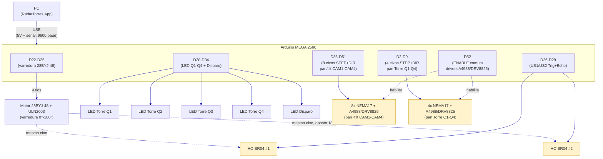

# Diagrama Elétrico (conceitual/funcional)

> Hardware real implementado em `Arduino/RadarTorres_Firmware/RadarTorres_Firmware.ino` (983 linhas,
> 13 motores de passo). Os componentes abaixo foram confirmados com o autor em 2026-09-19 (versão
> Uno/1 servo/1 sensor) e **substituídos** pela topologia real extraída diretamente do firmware em
> 2026-10-26 — ver nota de rastreabilidade no fim de cada seção. Este diagrama mostra **quais sinais
> ligam a quais pinos** — não é um esquemático elétrico completo (footprints/trilhas); para a
> montagem física, use uma ferramenta dedicada (Fritzing/KiCad).
>
> **`Arduino/ArduinoSimulation.ino` continua existindo** só para validar o protocolo serial sem
> hardware (não documentado aqui — é ferramenta de teste, não topologia de produção).
>
> O diagrama PlantUML (`Diagrama_Eletrico/Diagrama_Eletrico_RadarTorres.puml`) e o PNG exportado
> na mesma subpasta já foram regenerados (2026-10-27) a partir das tabelas abaixo, refletindo a
> topologia real.

## 1. Componentes

| Componente | Quantidade | Papel | Observação |
|---|---|---|---|
| Arduino MEGA 2560 | 1 | Microcontrolador (ATmega2560, lógica 5V) | Substituiu o Uno: 13 motores de passo não cabem nos ~20 pinos do Uno. Alimentado via USB pelo PC — mesma porta usada para o protocolo serial (`Docs/Tecnica/COMUNICACAO_ARDUINO.md`) |
| Motor de passo 28BYJ-48 + driver ULN2003 | 1 | Varredura angular em zigue-zague (0°-180°) da torre central | 4 fios (IN1-IN4), controlado via biblioteca AccelStepper (modo FULL4WIRE) |
| Sensor ultrassônico HC-SR04 | 2 | Medem distância na posição angular atual, montados **opostos a 180° no mesmo eixo** de varredura — juntos cobrem os 360° a cada ciclo ida-e-volta | Lógica 5V — compatível direto com o MEGA, sem divisor de tensão. SENSOR=2 sempre reporta ângulo = ângulo do motor + 180° (mod 360) |
| Motor de passo NEMA17 + driver A4988/DRV8825 | 8 | Mira (pan + tilt) das 4 câmeras CAM1-CAM4 — 2 eixos por câmera, para centralizar o alvo detectado pela visão computacional do PC | STEP+DIR por eixo; enable compartilhado com os motores de torre |
| Motor de passo NEMA17 + driver A4988/DRV8825 | 4 | Mira (pan apenas, modelo 2D) das torres de decisão Q1-Q4 | STEP+DIR por eixo; gira a torre selecionada na direção do alvo (ver `TowerSelectionService`, lado PC) |
| LED + resistor 220Ω (torre) | 4 | Indicador de torre selecionada (1 por quadrante Q1-Q4) | Ver `enum Quadrant` em `src/RadarTorres.App/Models/SystemState.cs` |
| LED + resistor 220Ω (disparo) | 1 | Indicador dedicado ao evento de disparo (Requisito 3) | Só acende por `FIRE` explícito do PC, com `COLOR;STATE=VERMELHO` e alvo estável — nunca automático por centralização momentânea |

Total de eixos controlados (não bloqueante, via AccelStepper): **13** (1 varredura + 8 mira de câmeras + 4 mira de torres).

## 2. Pinagem (confirmada no firmware — `RadarTorres_Firmware.ino`, bloco "PINAGEM (MEGA 2560)")

### 2.1 Varredura central (28BYJ-48 / ULN2003)

| Sinal | Pino MEGA 2560 |
|---|---|
| IN1 | D22 |
| IN2 | D23 |
| IN3 | D24 |
| IN4 | D25 |

### 2.2 Sensores ultrassônicos (HC-SR04 x2)

| Sinal | Pino MEGA 2560 |
|---|---|
| US1 — Trig | D26 |
| US1 — Echo | D27 |
| US2 — Trig | D28 |
| US2 — Echo | D29 |

### 2.3 LEDs

| Sinal | Pino MEGA 2560 |
|---|---|
| LED Torre Q1 | D30 |
| LED Torre Q2 | D31 |
| LED Torre Q3 | D32 |
| LED Torre Q4 | D33 |
| LED Disparo | D34 |

### 2.4 Motores de mira das câmeras (NEMA17 + A4988/DRV8825, 8 eixos)

Enable compartilhado entre os 8 drivers de câmera **e** os 4 drivers de torre: **D52** (ativo em LOW).

| Eixo | STEP | DIR |
|---|---|---|
| CAM1 — Pan | D36 | D37 |
| CAM1 — Tilt | D38 | D39 |
| CAM2 — Pan | D40 | D41 |
| CAM2 — Tilt | D42 | D43 |
| CAM3 — Pan | D44 | D45 |
| CAM3 — Tilt | D46 | D47 |
| CAM4 — Pan | D48 | D49 |
| CAM4 — Tilt | D50 | D51 |

### 2.5 Motores de mira das torres (NEMA17 + A4988/DRV8825, 4 eixos — só pan)

| Eixo | STEP | DIR |
|---|---|---|
| Torre Q1 — Pan | D2 | D3 |
| Torre Q2 — Pan | D4 | D5 |
| Torre Q3 — Pan | D6 | D7 |
| Torre Q4 — Pan | D8 | D9 |

> **A confirmar**: o firmware não declara explicitamente um pino de alimentação dedicado para os
> drivers (VMOT dos A4988/DRV8825, tipicamente 8-35V externo, separado dos 5V lógicos do MEGA) nem a
> fiação física VCC/GND de cada HC-SR04/driver — só os pinos de sinal (STEP/DIR/TRIG/ECHO/ENABLE)
> estão no `.ino`. A topologia de alimentação (quantas fontes externas, distribuição de GND comum)
> não está no firmware e precisa ser definida/validada na montagem física.

## 3. Diagrama

Legenda: azul = sinal/dados digital. Blocos em amarelo (motores NEMA17 e sensores US1/US2) têm
alimentação (VMOT dos drivers, VCC dos HC-SR04) **não detalhada no firmware** — ver nota na seção
2.5. Fonte PlantUML: [`Diagrama_Eletrico_RadarTorres.puml`](Diagrama_Eletrico/Diagrama_Eletrico_RadarTorres.puml),
já regenerada (2026-10-27) para esta topologia.

## 4. Protocolo serial — mensagens novas (ver `Docs/Tecnica/COMUNICACAO_ARDUINO.md` para o protocolo base)

O firmware real estende o protocolo textual já documentado (`TIPO;CHAVE=VALOR`, 9600 baud,
terminador `\n`):

| Direção | Mensagem | Descrição |
|---|---|---|
| Arduino → PC | `USONIC;SENSOR=<1\|2>;ANGLE=<0-360>;DIST=<cm>` | Leitura de um dos 2 ultrassônicos, associada ao ângulo do motor de varredura no instante da leitura |
| PC → Arduino | `COLOR;STATE=VERDE\|AMARELO\|VERMELHO` | Estado operacional do semáforo de segurança (máquina de estados de 3 níveis; distinto de `MODE;DETECTION\|AUTO`) |
| PC → Arduino | `CAM;ID=<1-4>;X=<px>;Y=<px>;Z=<cm>` | Deslocamento do alvo (X: +direita, Y: +abaixo) e distância estimada para a câmera CAM`<ID>` |
| PC → Arduino | `CALIB;CAM=<1-4>;PASSOS_POR_PX_PAN=<float>;PASSOS_POR_PX_TILT=<float>` | Ajusta em runtime a calibração pixel→passo de uma câmera |
| PC → Arduino | `AIM;TOWER=<1-4>;ANGLE=<0.0-360.0>` | Gira o eixo pan da torre indicada (convenção de bússola, 0°=Norte, sentido horário) |
| PC → Arduino | `FIRE;TOWER=<id>;TARGET=<id>` (reaproveitada) | Aciona LED_DISPARO — só tem efeito com `COLOR;STATE=VERMELHO` e alvo estável |
| PC → Arduino | `GENOMA;RESET` / `GENOMA;INDICE=<0-73>;VALOR=<float>` / `GENOMA;COMMIT` | Carrega os 74 pesos/viés da rede neural embutida (mesma ordem de `RedeNeural.cs`, lado PC) |
| PC → Arduino | `REDE;ENTRADAS=<d>;<mesmo_quad>;<quad_adj>;<angulo>;<vel>;<fator_camada>` | Pede o cálculo da rede embutida para 6 entradas |
| Arduino → PC | `STATUS;REDE_AJUSTE=<float>;REDE_CONFIANCA=<float>` | Resposta a `REDE;ENTRADAS` — **somente diagnóstico**, nunca aciona atuador algum (invariante de segurança explícita no firmware) |

A máquina de estados (VERDE/AMARELO/VERMELHO) e a rede neural embutida (6 entradas → 8 ocultos → 2
saídas, 74 genes, ativação tanh) espelham, respectivamente, o `Requisito 4` e
`src/RadarTorres.App/NeuralEvolution/RedeNeural.cs` do lado PC — ver
`Docs/Documentos_Entregaveis/Como_a_IA_funciona_no_RadarTorres.md` para o funcionamento da
rede.

## 5. Observações

- **Alimentação dos motores de passo**: os drivers A4988/DRV8825 (12 ao todo: 8 de câmera + 4 de
  torre) tipicamente exigem VMOT externo (8-35V) separado da lógica 5V do MEGA — o firmware não
  especifica fonte/distribuição; **a confirmar** na montagem física.
- **Alimentação do 28BYJ-48**: motores de passo unipolares desse tipo normalmente toleram 5V direto
  do driver ULN2003, mas correntes de pico ao mover + os 2 HC-SR04 simultâneos podem exigir fonte
  externa para não picar o 5V do MEGA via USB (mesmo cuidado que já existia na versão com servo).
- **Echo dos HC-SR04 em 5V**: compatível direto com a lógica 5V do MEGA 2560, sem divisor de tensão.
- **Microstepping**: `CAM_MICROPASSOS` e `TORRE_MICROPASSOS` estão fixados em 16 no firmware,
  mas dependem do jumper físico MS1/MS2/MS3 de cada driver A4988/DRV8825 — **a confirmar**
  configuração física antes de usar em produção (comentário explícito no `.ino`).
- **Passos por volta do 28BYJ-48**: `SWEEP_STEPS_POR_VOLTA = 2048` é valor de referência para
  gearbox ~64:1 — **a confirmar** no motor real (seção "CALIBRAÇÃO" do `.ino`).
- **Calibração pixel→passo das câmeras**: valores iniciais (`camPassosPorPixelPan/Tilt = 2.0`) são
  placeholder — devem ser medidos na prática e podem ser ajustados em runtime via `CALIB` sem
  regravar o firmware.
- **LED de disparo**: tratado como evento, não estado contínuo — acende por `FIRE` explícito só em
  `COLOR;STATE=VERMELHO` com alvo estável, e apaga automaticamente após `LED_DISPARO_DURACAO_MS`
  (400 ms), sem precisar de segundo comando do PC.

## Ver também

- [[COMUNICACAO_ARDUINO]] — protocolo serial base que trafega entre o PC e este hardware.
- [[Diagrama_de_Implantacao]] — topologia física PC ↔ Arduino em nível mais alto.
- [[ALGORITMO_SELECAO_TORRE]] — lógica de seleção de torre (lado PC) que envia `AIM`/`FIRE`.
- [[Como_a_IA_funciona_no_RadarTorres]] — explicação da rede neural espelhada no Arduino (`GENOMA`/`REDE`).
