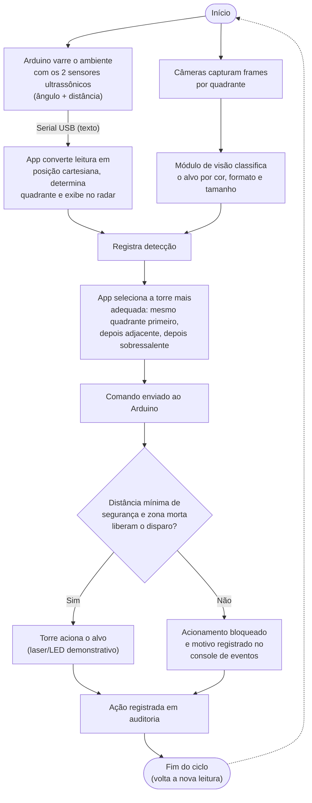

Funcionalidade: descreve o fluxo operacional do sistema, da leitura dos sensores à ação da torre.

# Fluxo Operacional

Fluxograma do ciclo completo de operação do RadarTorres, do início da varredura até o registro
em auditoria — uma visão de alto nível, complementar ao [[Diagrama_de_Implantacao]] (física) e ao
[[ALGORITMO_SELECAO_TORRE]] (matemática da seleção).

Fonte: [`fluxo_operacional.mmd`](Fluxo_Operacional/fluxo_operacional.mmd) (Mermaid), renderizado em
[`Fluxo_Operacional.png`](../../assets/Fluxo_Operacional.png).

## Notas

- Este fluxo descreve o caminho **feliz + bloqueio por segurança**; não cobre o controlador
  neuroevolutivo (ver [[CONTROLADOR_NEUROEVOLUTIVO]]) nem as 5 regras heurísticas desligáveis —
  ambos atuam *dentro* da etapa "App seleciona a torre mais adequada".
- "Zona morta" refere-se a `IZonaMortaService`, que pode bloquear o disparo mesmo com alvo
  detectado e torre selecionada.

## Ver também

- [[Diagrama_de_Implantacao]] — topologia física PC ↔ Arduino.
- [[ALGORITMO_SELECAO_TORRE]] — critério de seleção de torre em detalhe.
- [[CONTROLADOR_NEUROEVOLUTIVO]] — controlador híbrido que decide dentro da etapa de seleção.
- [[index|Índice]] (raiz do vault), [[Artigo_index|Artigo]].
