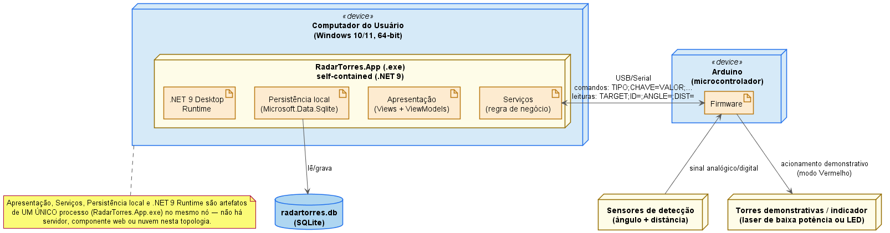

# Diagrama de Implantação

> Base desta análise: `installer/RadarTorres.iss` (instalador), `src/RadarTorres.App/App.xaml.cs`
> (composition root), `src/RadarTorres.App/RadarTorres.App.csproj` (versões de dependências),
> `Arduino/ArduinoSimulation.ino` e `Docs/Tecnica/COMUNICACAO_ARDUINO.md` (protocolo serial).
> Nenhum nó, artefato ou protocolo foi inventado.

## 1. Nós e elementos

| Nó | Elemento | Papel |
|---|---|---|
| Computador do Usuário (Windows 10/11, 64-bit) | `RadarTorres.App` (.exe) | Único processo, self-contained (.NET 9), instalado por `installer/RadarTorres.iss` |
| ↳ dentro do processo | Apresentação (`Views` + `ViewModels`) | Captura interação do operador, binding declarativo (`ViewModelBase`, `RelayCommand`) |
| ↳ dentro do processo | Serviços (regra de negócio) | `ISerialCommunicationService`, `ITargetTrackingService`, `ITowerSelectionService`, `IFireControlService`, `IZonaMortaService`, `IAuthService`, `IPermissionService` |
| ↳ dentro do processo | Persistência local | Leitura/escrita do banco SQLite via `Microsoft.Data.Sqlite` (`SqliteConnectionFactory`/`Sqlite*Repository`) |
| ↳ dentro do processo | .NET 9 Desktop Runtime | Embutido pelo instalador — sem dependência externa a instalar |
| Arduino (microcontrolador) | Firmware | Lê sensores, envia leituras de alvo, recebe comandos, aciona torres demonstrativas |
| Armazenamento local (disco do usuário) | `radartorres.db` (SQLite) | Usuários, auditoria, objetos detectados, preferências e demais dados cadastrais; CSV permanece apenas como exportação manual da tela de Objetos Detectados |
| Sensores de detecção | — | Ângulo + distância, alimentam o Arduino |
| Torres demonstrativas / indicador | — | Laser de baixa potência ou LED, nunca armamento real |

## 2. Diagrama de Implantação

Diagrama fonte: [`Implantacao_RadarTorres.puml`](Implantacao_RadarTorres.puml).

## 3. Protocolo de comunicação (USB/Serial)

O único canal entre os dois nós físicos é a porta serial sobre USB, com mensagens em texto
simples (ver `Docs/Tecnica/COMUNICACAO_ARDUINO.md` para a especificação completa):

| Direção | Formato | Finalidade |
|---|---|---|
| Computador → Arduino | `TIPO;CHAVE=VALOR;...` | Comandos (troca de modo, acionamento, configuração) |
| Arduino → Computador | `TARGET;ID=;ANGLE=;DIST=` | Leituras de alvo (ângulo + distância detectados) |

Não há reconhecimento criptográfico nem autenticação no link serial — a segurança do sistema
depende do controle de acesso físico ao cabo USB e do fato de o Arduino ser um periférico
dedicado, sem acesso a rede.

## 4. Explicação

O diagrama representa apenas **dois nós físicos reais**: o computador do usuário e o Arduino,
conectados exclusivamente por **USB/Serial**. Não há servidor, componente web ou nuvem nessa
topologia — decisão deliberada, para não representar infraestrutura que o RadarTorres não possui.

O diagrama usa a notação UML padrão de implantação: `Computador do Usuário` e `Arduino` são nós
físicos marcados com o estereótipo **«device»**; dentro do nó do computador, o processo
`RadarTorres.App.exe` é um nó de ambiente de execução que contém quatro **«artifact»**
(Apresentação, Serviços, Persistência local, .NET 9 Runtime) — artefatos de software do mesmo
processo, não componentes distribuídos em máquinas ou processos separados. O banco de dados
(`radartorres.db`) é representado com o ícone de cilindro (**database**), reservado para dados
persistidos pelo sistema. Os dois acoplamentos mais relevantes do processo saem da caixa para
fora: Serviços comunica-se com o Arduino pela porta serial, e a camada de Persistência lê/grava o
banco SQLite local em disco.

Do lado do Arduino, o Firmware concentra as quatro responsabilidades físicas do dispositivo:
ler os sensores de ângulo/distância, enviar leituras de alvo ao computador, receber comandos e
acionar as torres demonstrativas.

A escolha por um único processo desktop self-contained, sem servidor, é coerente com o argumento
de segurança/leveza já discutido para o SGBD (ver
[`Modelo_Banco_de_Dados.md`](../../Banco_de_Dados/Modelo_Banco_de_Dados.md)): menor superfície de
ataque (nenhuma porta de rede exposta), zero administração de infraestrutura e instalação
totalmente local, adequadas ao perfil de nó único do protótipo.

## 5. Validação

* Nós, artefato e protocolo confirmados em `installer/RadarTorres.iss`, `App.xaml.cs` e
  `Docs/Tecnica/COMUNICACAO_ARDUINO.md`.
* Driver de persistência (`Microsoft.Data.Sqlite` 9.0.0) confirmado em
  `src/RadarTorres.App/RadarTorres.App.csproj:50`.
* A segregação em quatro blocos internos (Apresentação/Serviços/Persistência/Runtime) é
  **didática**, não uma leitura de componentes fisicamente distribuídos — ver Seção 6 de
  [`UML_RadarTorres.md`](../UML_RadarTorres.md).

## Ver também

- [[UML_RadarTorres]] — Seção 6, discussão conceitual deste diagrama.
- [[COMUNICACAO_ARDUINO]] — protocolo que trafega na ligação USB/serial representada aqui.
- [[Diagrama_Eletrico]] — detalhe físico/pinagem do nó Arduino.
- [[Modelo_Banco_de_Dados]] — especificação completa do SGBD usado na camada de Persistência.
