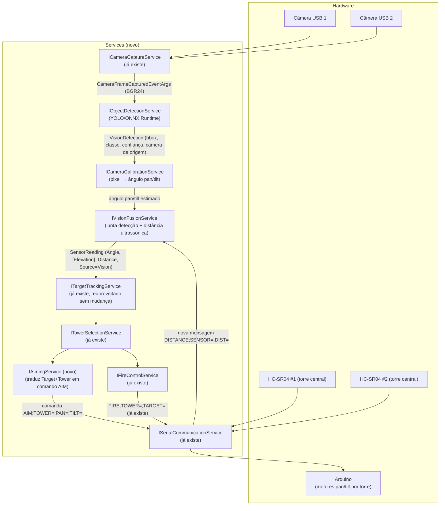

Funcionalidade: documenta a Etapa 2 do desenvolvimento: módulo de visão computacional (detecção YOLO e mira pan/tilt).

# Etapa 2 — Módulo de visão computacional (detecção YOLO + mira pan/tilt)

> Documento de **planejamento apenas** — nenhum código foi escrito nesta etapa. Objetivo:
> decidir arquitetura, fluxo de dados, extensão do protocolo serial e interfaces propostas
> antes de implementar. Ver seção 7 para as perguntas que precisam de decisão do usuário
> antes de qualquer linha de código.

## Status atual (atualizado em 2026-10-26)

Parte deste plano **já foi implementada**, mas com uma arquitetura diferente da proposta
abaixo nas seções 2 e 4. O restante do documento é mantido como registro do planejamento
original — não foi atualizado linha a linha, só esta nota foi acrescentada no topo.

**O que de fato existe hoje no código:**

- Detecção de objetos via YOLO/ONNX está implementada em
  `src/RadarTorres.App/Services/OnnxYoloDetectionService.cs`, que roda o modelo
  `tiny-yolov3-11.onnx` localmente via `Microsoft.ML.OnnxRuntime` — confirmando a decisão de
  "C# in-process" da seção 1.
- A interface `IObjectDetectionService` (`src/RadarTorres.App/Services/IObjectDetectionService.cs`)
  existe como proposto na seção 4, recebendo um `Bitmap` e devolvendo uma lista de
  `VisionDetection` (`src/RadarTorres.App/Models/VisionDetection.cs`) — mas o DTO real tem
  campos diferentes do proposto (`BoxXPx`, `BoxYPx`, `BoxWidthPx`, `BoxHeightPx`, `Score`; sem
  `CameraId`/`Timestamp`).
- A classificação "isto é o alvo?" **não** segue o fluxo pixel→ângulo→fusão descrito nas
  seções 2 e 4. Em vez disso, existe `IAlvoVisualService`/`AlvoVisualService`
  (`src/RadarTorres.App/Services/IAlvoVisualService.cs`, `AlvoVisualService.cs`), que compara
  cada `VisionDetection` com um `PerfilAlvo` (`src/RadarTorres.App/Models/PerfilAlvo.cs`,
  com `CorAlvo`/`FormatoAlvo`) para decidir cor/forma do alvo — um propósito diferente do
  "pixel → ângulo pan/tilt" descrito aqui.

**O que do plano original NÃO existe:**

- `ICameraCalibrationService` — não existe nenhum arquivo com esse nome ou com esse
  propósito (calibração câmera → ângulo) no código atual.
- `IVisionFusionService` — não existe. Não há fusão entre detecção visual e leitura dos
  sensores ultrassônicos HC-SR04; o pipeline real de visão (detecção + `IAlvoVisualService`)
  não produz `SensorReading` nem chama `ITargetTrackingService.ProcessReading`.
- `IAimingService` — não existe. Não há comando `AIM;TOWER=;PAN=;TILT=` nem equivalente;
  nada no protocolo serial atual envia pan/tilt calculado a partir de uma detecção visual.

Em resumo: a parte de **detecção** (câmera → bounding boxes → classificação por perfil de
alvo) foi implementada e segue um propósito de reconhecimento/classificação do alvo, não o
pipeline completo de mira por visão computacional (pixel → ângulo → fusão com ultrassônico →
`AIM` para o Arduino) planejado neste documento. Esse pipeline de mira continua não
implementado.

## 0. Contexto e o que já existe

O módulo "Câmeras" (`CamerasViewModel`/`CameraSlotViewModel`/`ICameraCaptureService`,
via AForge.Video.DirectShow) já está implementado e **só visualiza** — sem gravação, captura
de foto ou processamento de imagem (ver `Docs/Projeto/LOG_SOLICITACOES.md`). Ele já expõe,
por painel, um evento `FrameCaptured` com o quadro decodificado em `byte[]` BGR24 cru (sem
depender de WPF/GDI+ na camada de Services) — esse é exatamente o ponto de entrada natural
para a detecção, sem precisar duplicar nada de captura.

Também já existe, nesta branch, um modelo YOLO pré-treinado commitado em
`src/RadarTorres.App/ComputerVision/Models/YoloModel/tiny-yolov3-11.onnx` (33,9 MB), mas
nenhum código ainda o consome. A presença desse arquivo foi o maior sinal considerado na
recomendação da seção 1.

Hardware confirmado nesta sessão:
- **2 câmeras USB** ligadas ao PC (confirmado — não 4).
- **2 sensores ultrassônicos HC-SR04 fixos** na torre central (sem motor — cobrem zonas
  fixas, não fazem varredura angular).
- **Torres demonstrativas** ao redor da base, cada uma com **2 motores 28BYJ-48** (pan e
  tilt), guiadas pelo Arduino a partir de comandos vindos do PC.

### Lacuna importante no modelo de domínio atual

`Target`/`SensorReading`/`Tower` só guardam um único ângulo (`Angle`, 0–360° no plano
horizontal) e uma distância. **Não existe campo de elevação/tilt em nenhum lugar do
domínio atual.** Isso é esperado — até agora o protocolo supunha que o próprio Arduino
soubesse o ângulo do alvo (e o `ANGLE` do `TARGET` era alimentado por simulação/placeholder,
já que não havia sensor real de varredura angular). Com a visão computacional, o PC passa a
ser a fonte do ângulo (e potencialmente da elevação) — isso tem impacto direto em
`Target`/`SensorReading` e é tratado como decisão aberta na seção 6.

---

## 1. Decisão de arquitetura: processamento em C# (in-process) vs. serviço Python separado

| Critério | C# in-process (OpenCvSharp/ONNX Runtime no próprio app) | Serviço Python separado (FastAPI/WebSocket local) |
|---|---|---|
| Deploy | Continua um único `Setup.exe` self-contained — sem instalar runtime Python na máquina do usuário final | Precisa embutir um Python (PyInstaller ou similar) **ou** exigir Python já instalado — quebra a promessa atual do instalador ("usuário final não precisa instalar nada") |
| Processos/IPC | Nenhum processo extra; frame já está em memória (BGR24) vindo do `ICameraCaptureService` | App C# vira cliente de um processo filho — precisa gerenciar ciclo de vida (start/kill), serializar frames (JPEG/PNG) por WebSocket, tratar timeouts/crash do processo — complexidade nova inteira |
| Latência | Menor — sem serialização de imagem nem round-trip de rede local | Maior — cada frame precisa ser codificado, enviado, decodificado do outro lado |
| Ecossistema YOLO | ONNX Runtime (Microsoft.ML.OnnxRuntime) roda ONNX direto, incluindo o modelo já commitado; pré-processamento (resize/letterbox/normalização) via OpenCvSharp4 ou código manual | Ecossistema Python (ultralytics/opencv-python) é mais maduro para treinar/trocar modelos, mas aqui o modelo já está fixo em ONNX — essa vantagem não se aplica |
| Coerência com o projeto | Mantém o padrão já estabelecido (`I*Service` em `Services/`, sem dependências de infraestrutura externa, igual ao resto do app) | Introduz um padrão de arquitetura (serviço + API local) que não existe em nenhum outro lugar do projeto — mais difícil de explicar na defesa do TCC junto com o resto |
| Testabilidade | Mesma abordagem de dublê de interface já usada em todo o projeto (`ISerialCommunicationService`, `ICameraCaptureService`) | Precisaria mockar o client HTTP/WebSocket, ou rodar o serviço Python nos testes |

**Recomendação: processamento in-process em C#**, usando `Microsoft.ML.OnnxRuntime` para
rodar o modelo `tiny-yolov3-11.onnx` já presente no repositório. É a opção que menos diverge
do que já existe (instalador self-contained, sem processos externos, mesmo padrão de
`I*Service`) e elimina uma classe inteira de problemas (serialização de frame, IPC, ciclo de
vida de processo filho) que um serviço Python local introduziria sem necessidade, já que o
modelo não vai ser re-treinado nem trocado por algo que exija o ecossistema Python.

Dentro da opção in-process, uma sub-decisão: **pré-processamento do frame (resize/letterbox
para a entrada 416×416 do tiny-YOLOv3) via OpenCvSharp4 ou manualmente.** OpenCvSharp4 é o
caminho mais comum/documentado para isso, mas adiciona uma dependência nativa (~40-80 MB no
instalador) só para essa etapa. Pré-processamento manual (redimensionar o `byte[]` BGR24 que
já vem do `ICameraCaptureService`) evita a dependência, mas é mais código "na mão". **Isso
também fica como decisão aberta (seção 7, pergunta 3)** — ambas são viáveis, a diferença é
custo de instalador vs. código próprio.

---

## 2. Fluxo de dados: câmera → detecção → ângulo → fusão → serial → Arduino

Onde cada etapa se encaixa nas camadas atuais:

| Etapa | Camada | Observação |
|---|---|---|
| Captura de frame | `Services` (já existe) | Zero mudança — `ICameraCaptureService` já entrega BGR24 cru |
| Detecção YOLO | `Services` (novo, `ComputerVision/` ou `Services/Vision/`) | Consome o evento `FrameCaptured` de cada painel de câmera já em uso |
| Pixel → ângulo | `Services` (novo) | Depende de calibração por câmera (posição/orientação física fixa) — ver riscos, seção 5 |
| Fusão com ultrassônico | `Services` (novo) | Correlaciona por janela de tempo + qual câmera/sensor cobre qual zona |
| Rastreamento, seleção de torre | `Services` (já existe, **sem alterar**) | Ponto de extensão já documentado em `ARQUITETURA.md` §5: "Novo tipo de sensor/fonte de dados: basta produzir objetos `SensorReading` e chamar `ITargetTrackingService.ProcessReading`" |
| Mira (pan/tilt) | `Services` (novo) | Não existe hoje — Arduino nunca recebeu um ângulo "de fora"; ver seção 3 |
| Acionamento | `Services` (já existe, **sem alterar**) | `FireControlService`/`FIRE` continuam iguais |
| Exibição | `ViewModels`/`Views` | Radar continua mostrando `Target` normalmente; tela de Câmeras pode opcionalmente desenhar as bounding boxes por cima do frame (decisão de UI separada, não bloqueia o core) |

---

## 3. Protocolo serial: o que já existe e o que precisa ser acrescentado

Tudo proposto abaixo é **aditivo** — nenhuma mensagem existente (`TARGET`, `STATUS`, `ACK`,
`ERROR`, `SYSTEM`, `MODE`, `SET`, `FIRE`) muda de formato ou comportamento.

### 3.1 Arduino → PC (novo)

| Mensagem | Campos | Exemplo | Motivo |
|---|---|---|---|
| `DISTANCE` | `SENSOR` (1\|2), `DIST` (metros) | `DISTANCE;SENSOR=1;DIST=2.80` | Os HC-SR04 são fixos (sem varredura), então não fazem sentido como `TARGET` (que tem `ID`+`ANGLE`). Precisam de uma mensagem própria, reportada continuamente, para o `IVisionFusionService` consultar a leitura mais recente de cada sensor. |
| `AIMED` | `TOWER` (int) | `AIMED;TOWER=1` | Confirma que a torre terminou de se posicionar (pan+tilt) após um `AIM`. Opcional — ver pergunta 4 da seção 7: sem isso, o PC não sabe quando é seguro acionar `FIRE` depois de mirar. |

### 3.2 PC → Arduino (novo)

| Comando | Exemplo | Efeito esperado no firmware |
|---|---|---|
| `AIM` | `AIM;TOWER=1;PAN=45.0;TILT=12.5` | Move os dois motores 28BYJ-48 da torre indicada para o ângulo pan/tilt informado (graus). É o comando que faltava — hoje nada no protocolo diz ao Arduino **para onde apontar**; o `FIRE` atual assume que a torre já está apontada. |

### 3.3 Sem mudanças

`TARGET` continua existindo como está (para simulação e para um eventual sensor de
varredura futuro) — a nova fonte de dados (visão) não o substitui, apenas se junta a ele como
mais uma origem de `SensorReading` (`DataSource` já é um enum extensível: `Serial`,
`Simulation`, e passaria a ter `Vision`).

---

## 4. Interfaces e classes novas propostas

Nomenclatura seguindo o padrão já usado (`I*Service` em `Services/`, DTOs simples em
`Models/` ou junto do serviço). Nenhuma classe abaixo foi criada — são apenas o nome e a
responsabilidade propostos.

| Nome | Camada/pasta | Responsabilidade | Impacto em arquivos existentes |
|---|---|---|---|
| `IObjectDetectionService` / `OnnxYoloDetectionService` | `Services/Vision/` (novo) | Recebe um frame BGR24 (mesmo formato de `CameraFrameCapturedEventArgs`) e devolve as detecções (bbox, classe, confiança) usando o modelo ONNX já commitado | Nenhum — só consome o evento já existente de `ICameraCaptureService` |
| `VisionDetection` (DTO) | `Models/` (novo) | `CameraId`, `BoundingBox` (x,y,largura,altura em pixels), `Confidence`, `Timestamp` | Nenhum |
| `ICameraCalibrationService` / `CameraCalibrationService` | `Services/Vision/` (novo) | Converte posição de pixel (centro da bbox) + câmera de origem em ângulo pan/tilt, usando parâmetros de calibração fixos por câmera (FOV, posição/orientação física) | Nenhum — parâmetros vêm de uma nova seção `CameraCalibration` em `appsettings.json` |
| `IVisionFusionService` / `VisionFusionService` | `Services/Vision/` (novo) | Junta `VisionDetection` convertido em ângulo com a leitura `DISTANCE` mais recente e relevante, produz um `SensorReading` (`Source = DataSource.Vision`) e chama `ITargetTrackingService.ProcessReading` | **Nenhuma mudança em `TargetTrackingService`** — é só mais um chamador, igual ao `SimulationService` hoje |
| `DataSource.Vision` (novo valor de enum) | `Models/SensorReading.cs` | Distingue leituras vindas da visão das de serial/simulação, para log e depuração | Edição aditiva de um `enum` existente |
| `IAimingService` / `AimingService` | `Services/` (novo) | Depois que `ITowerSelectionService.SelectTowerFor` escolhe uma torre, calcula o pan/tilt necessário (a partir da posição do alvo) e envia o comando `AIM` via `ISerialCommunicationService` | Nenhuma mudança na assinatura de `ITowerSelectionService` — `AimingService` apenas observa o resultado já retornado |
| `SerialProtocolParser.BuildAim(int towerId, double pan, double tilt)` | `Services/SerialProtocolParser.cs` | Monta a string `AIM;TOWER=;PAN=;TILT=` | **Edição aditiva** — novo método estático, nenhum existente muda |
| `SerialProtocolParser` — novos casos `DISTANCE`/`AIMED` em `TryParse` | `Services/SerialProtocolParser.cs` | Interpreta as novas mensagens do Arduino | **Edição aditiva** — novos `case` no `switch`, nenhum caso existente muda |
| `DistanceReading` (DTO) | `Models/` (novo) | `SensorId`, `Distance`, `ReceivedAt` — lido de `DISTANCE` | Nenhum |

### Pergunta de modelagem ainda aberta (ver seção 6)

Se a elevação (tilt) do alvo precisar ser carregada além do pan, `Target`/`SensorReading`
precisarão de um campo novo (`Elevation`/`Tilt`, nullable). Essa é a única mudança proposta
que toca um **modelo existente** em vez de só adicionar algo novo ao lado — por isso está
destacada separadamente como decisão a confirmar, não assumida aqui.

---

## 5. Riscos e questões técnicas em aberto

1. **Calibração câmera → ângulo.** Converter pixel em ângulo pan exige saber o campo de
   visão (FOV) da câmera e sua posição/orientação física exata em relação ao centro da base.
   Sem um processo de calibração (ainda que manual, por medição), os ângulos calculados terão
   erro sistemático. Precisa de um procedimento definido (ver pergunta 2, seção 7).
2. **FPS/latência do tiny-YOLOv3 em CPU.** `tiny-yolov3-11.onnx` é a variante leve do YOLOv3,
   mas ainda assim rodar em CPU (sem GPU dedicada) pode não atingir um FPS que mantenha o
   rastreamento fluido com 2 câmeras simultâneas. Precisa validação empírica cedo (prova de
   conceito de 1 câmera antes de paralelizar para 2).
3. **Correlação visão ↔ ultrassônico quando há múltiplos alvos.** Com mais de um alvo em
   cena, associar cada detecção de câmera à leitura ultrassônica certa (dos 2 sensores fixos)
   não é trivial — depende de que zona cada sensor cobre e de que a câmera correspondente
   esteja de fato cobrindo a mesma zona. Isso deve ser avaliado com cautela: **o caso de um
   único alvo por vez é bem mais simples** e pode ser o escopo inicial.
4. **Modo simulação sem hardware.** O projeto já tem `SimulationService` para gerar alvos sem
   Arduino. A visão computacional também precisa de um modo sem câmera/hardware real para
   testes (ex.: alimentar `IObjectDetectionService` com imagens/vídeos gravados em vez da
   câmera ao vivo) — a ser definido.
5. **Tempo de resposta dos motores 28BYJ-48 (step motor, não servo).** Motores de passo são
   mais lentos para grandes excursões de ângulo que servos — pode haver uma defasagem
   perceptível entre "alvo detectado" e "torre apontada", relevante para decidir se vale a
   pena implementar o `AIMED` (confirmação de fim de movimento) da seção 3.1.

---

## 6. Decisão de modelagem a confirmar antes de codar

A pergunta central: **o tilt (elevação) do alvo deve ser modelado?**

- **Opção A — sim, desde já.** Adiciona `Elevation`/`Tilt` (nullable) a `SensorReading` e
  `Target`. Mais fiel à realidade física (motores de tilt existem e precisam de um valor),
  mas toca modelos existentes usados em todo o app (radar, seleção de torre, etc.) — mesmo
  que de forma aditiva (campo novo, nullable, sem quebrar nada que já lê `Angle`/`Distance`).
- **Opção B — não agora, calcular na hora de mirar.** `AimingService` estima o tilt só no
  momento de montar o comando `AIM`, a partir da distância e de uma altura padrão assumida do
  alvo (trigonometria simples), sem persistir elevação em lugar nenhum do domínio. Mais
  simples e não toca nenhum modelo existente, mas é uma aproximação (assume altura fixa) —
  aceitável para uma demonstração, mas vale deixar explícito que é uma simplificação.

---

## 7. Perguntas objetivas antes de implementar qualquer coisa

1. **Arquitetura (seção 1):** confirma C# in-process com ONNX Runtime (em vez de serviço
   Python separado)?
2. **Pré-processamento de imagem (seção 1):** OpenCvSharp4 (dependência nativa extra, caminho
   mais documentado) ou pré-processamento manual do `byte[]` BGR24 (sem dependência nova, mais
   código próprio)?
3. **Calibração câmera → ângulo (risco 1):** como a posição/orientação de cada câmera vai ser
   medida e informada ao sistema — valores fixos digitados manualmente em `appsettings.json`
   (`CameraCalibration`), ou um procedimento de calibração guiado na própria interface (ex.:
   apontar um objeto em 3 posições conhecidas)?
4. **Tilt no domínio (seção 6):** Opção A (campo novo em `Target`/`SensorReading`) ou Opção B
   (calculado só na hora de mirar, sem persistir)?
5. **Confirmação de mira (`AIMED`, seção 3.1):** o firmware deve confirmar quando a torre
   termina de se posicionar antes do PC liberar o `FIRE`, ou o PC pode assumir um tempo fixo de
   espera (mais simples, mas menos preciso) após enviar `AIM`?
6. **Escopo do alvo único vs. múltiplos alvos (risco 3):** a primeira versão do módulo deve
   assumir **um alvo por vez** (mais simples de validar e já cobre a demonstração do TCC), ou
   já precisa suportar múltiplos alvos simultâneos desde o início?

## Ver também

- [[ARQUITETURA]] — camadas e fluxo de dados atuais, ponto de extensão citado na seção 2.
- [[COMUNICACAO_ARDUINO]] — protocolo serial atual, estendido (de forma aditiva) na seção 3.
- [[CONTEXTO_PROJETO]] — estado geral do projeto referenciado na seção 0.
