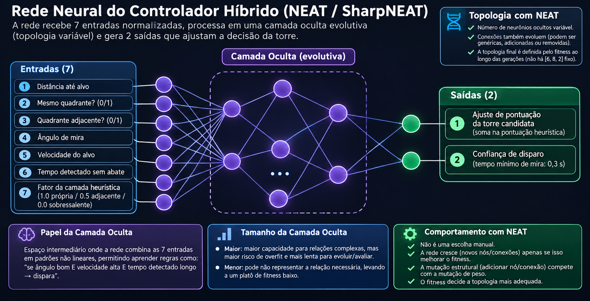

Funcionalidade: documenta o controlador híbrido heurística+rede neural evoluída (arquitetura, treino, parâmetros).

# Controlador Neuroevolutivo (Heurística + Rede Neural)

Documentação técnica do controlador híbrido que combina a heurística em camadas de seleção de
torre (ver [[ALGORITMO_SELECAO_TORRE]]) com uma rede neural evoluída por **NEAT** (via
SharpNEAT). Código-fonte em `src/RadarTorres.App/NeuralEvolution/`.

## 1. Visão geral

O objetivo deste módulo é refinar a escolha de torre e a decisão do instante de disparo além
do que a heurística pura (menor distância) consegue — sem substituí-la. A heurística continua
decidindo a **camada** de candidatas (torre do próprio quadrante → adjacente → sobressalente,
ver [[ALGORITMO_SELECAO_TORRE]] seção 4) e garante que a decisão nunca seja absurda (nunca
escolhe torre ocupada, nunca ignora a cooperação entre quadrantes). Dentro da camada escolhida,
uma rede neural evoluída por NEAT ajusta a pontuação das candidatas e decide o instante exato
do disparo.

O treinamento ocorre num **ambiente simulado** próprio (`AmbienteTreinamento`), separado do
sistema em produção, e o resultado (um genoma NEAT, isto é, um grafo de nós e conexões) é
exportado no formato `.net` do SharpNEAT e embutido no executável para ser usado em tempo real
por `TowerSelectionService`.

Framework de terceiros (SharpNEAT) para a evolução/topologia, mas a função de fitness, o
ambiente de simulação e a combinação heurística+rede continuam código próprio do projeto —
substituiu uma implementação 100% própria anterior (rede feedforward de topologia fixa +
algoritmo genético escrito à mão, ainda presentes no repositório como `RedeNeural.cs` e
`AlgoritmoGenetico.cs`, porém não mais usados no fluxo de treinamento/produção).

## 2. Classes principais

| Classe/arquivo | Responsabilidade |
|---|---|
| `RedeNeat.cs` | Adaptador fino sobre a rede do SharpNEAT (`IBlackBox<double>`): expõe `Ativar(entradas)` com a mesma assinatura da antiga rede fixa, cuidando da convenção de bias (nó de índice 0) e do reset entre ativações (necessário porque o NEAT pode gerar redes cíclicas, com estado interno). |
| `TreinadorNeat.cs` | Comanda a evolução pelo SharpNEAT: configura o experimento (população, nº de espécies, elitismo, teto de complexidade, probabilidade de mutação estrutural), roda `EvoluirGeracao` e decodifica o genoma campeão (`Decodificar`) numa `RedeNeat` pronta para uso. |
| `ControladorHibrido.cs` | Combina heurística + rede: monta o vetor de entradas, pontua candidatas (`Pontuar`) e decide o instante de disparo (`DecidirDisparo`). É a MESMA classe usada tanto no ambiente de treinamento quanto (via os métodos estáticos `ConstruirEntradas`/`Pontuar`) em produção por `TowerSelectionService`. |
| `AmbienteTreinamento.cs` | Mundo 2D de simulação: torres fixas (mesmas posições do `appsettings.json`), alvos nascendo na borda e avançando até a base. Função de fitness usada pelo NEAT (`ExecutarEpisodioRapido`/`AvaliarFitness`). |
| `EstadoEpisodio.cs` | Estado mutável de um episódio em andamento (torres, alvos, relógio, estatísticas). |
| `TorreTreinamento.cs` / `AlvoTreinamento.cs` | Modelos de torre e alvo exclusivos do ambiente de treinamento (não são `Tower`/`Target` do domínio real). |
| `ParametrosTreinamento.cs` | Parâmetros ajustáveis de um episódio (raio do mundo, velocidades, recompensas/penalidades, tamanho de população, parâmetros de mutação estrutural etc.), expostos na tela de treinamento. |
| `EpisodioResultado.cs` | Resumo de um episódio: fitness total, alvos abatidos/escapados, tiros errados. |
| `ExtratorDeRegras.cs` | Aproxima, por análise de sensibilidade (variação de cada entrada em torno de um ponto de referência), frases em português descrevendo tendências aprendidas pela rede — não é extração exata, é uma leitura qualitativa para acompanhar o treinamento. |

## 3. Arquitetura da rede




Desde a migração para **SharpNEAT** (`RedeNeat.cs`, `TreinadorNeat.cs`), não existe mais
arquitetura fixa de camadas — só entrada e saída são contrato fixo, definidas em
`ControladorHibrido.QuantidadeEntradas`/`QuantidadeSaidas`:

- **7 entradas** (`ConstruirEntradas`): distância normalizada até o alvo, indicador de mesmo
  quadrante, indicador de quadrante adjacente, ângulo de mira normalizado, velocidade do alvo
  normalizada, tempo detectado sem abate (normalizado), fator da camada heurística (1.0 =
  própria, 0.5 = adjacente, 0.0 = sobressalente).
- **Camada oculta evolutiva**: quantidade de neurônios ocultos e quais conexões existem (inclusive
  pulando camadas) são resultado da evolução por NEAT, não parâmetro de entrada — cresce ou
  encolhe geração a geração conforme o que melhora o fitness. Não há mais número fixo de
  neurônios nem genoma de tamanho previsível (o genoma agora é um grafo, não um vetor de pesos).
- **2 saídas**: ajuste de pontuação da torre candidata, e confiança de disparo.

`RedeNeat` expõe a caixa-preta do SharpNEAT com a mesma assinatura de `Ativar(entradas)` da
antiga rede fixa, para que `ControladorHibrido`, `ExtratorDeRegras` e `TowerSelectionService`
não precisem conhecer a API do framework. Internamente há um nó de bias (índice 0, sempre 1,0)
somado às 7 entradas reais — convenção do SharpNEAT, tratada só dentro de `RedeNeat`.

## 4. Como o controlador híbrido combina heurística + rede

### 4.1 Seleção de torre (`ControladorHibrido.SelecionarTorre` / `Pontuar`)

A pontuação final de uma torre candidata é:

```
pontuação = pontuação_heurística + ajuste_rede_neural
pontuação_heurística = (1 - distância_normalizada) + fator_camada
ajuste_rede_neural = rede.Ativar(entradas)[0]
```

Ou seja, a rede neural não decide do zero: ela **ajusta** uma pontuação heurística de base
(quanto mais perto e quanto "melhor" a camada, maior). Essa é a mesma combinação usada tanto
no ambiente de treinamento (`AmbienteTreinamento`/`ControladorHibrido.SelecionarTorre`) quanto
em produção (`TowerSelectionService.EscolherMelhorCandidata`, via os métodos estáticos
`ConstruirEntradas`/`Pontuar`).

### 4.2 Decisão de disparo (`ControladorHibrido.DecidirDisparo`)

A heurística impõe um limite inegociável: tempo mínimo de mira de 0,3 s
(`TempoMinimoDeMiraSegundos`) desde que a torre foi comprometida com o alvo. Passado esse
tempo, a rede decide o instante exato — a segunda saída da rede (`confiançaDisparo`) autoriza
o disparo quando é maior que zero. A distância até o alvo **não** é critério dentro desse
método; fora-de-zona-morta e certeza mínima são checados por quem chama (no treinamento,
`AmbienteTreinamento.DecidirDisparos`; em produção, `FireControlService`/regra de autorização).

### 4.3 Em produção (`TowerSelectionService`)

`TowerSelectionService` usa a rede treinada quando ela está disponível
(`IControladorTreinadoProvider.Rede` não nulo); caso contrário, cai para a heurística pura de
menor distância — comentário no código afirma que esse fallback é "idêntico ao que a rede
produz quando o genoma embutido é o zerado de fábrica". A margem de empate para a regra de
anti-oscilação (seção 7.1 de [[ALGORITMO_SELECAO_TORRE]]) muda conforme há ou não rede: 0,3 m
de distância sem rede, ou um valor de pontuação equivalente com rede.

## 5. Treinamento

### 5.1 Episódio de treinamento (`AmbienteTreinamento`)

Cada episódio simula um mundo circular de raio configurável (`RaioMundoMetros`, padrão 10 m)
com as mesmas posições de torre do `appsettings.json` (ou um layout padrão de 4 torres, uma
por quadrante, se não houver configuração — usado nos testes automatizados). Alvos nascem em
pontos aleatórios da borda e avançam em direção à base com um pequeno desvio angular (até
±30°), com velocidade sorteada entre `VelocidadeMinimaAlvoMetrosPorSegundo` e
`VelocidadeMaximaAlvoMetrosPorSegundo`.

Cada alvo também tem uma "certeza" de detecção que começa baixa (`CertezaBase`, sorteada entre
0,20 e 0,50) e sobe com o tempo de observação (`TaxaCrescimentoCertezaPorSegundo`, sorteada
entre 0,08 e 0,25 por segundo) — simula a câmera "confirmando" o alvo ao longo de vários
quadros. Só pode haver disparo quando essa certeza supera `LimiarConfiancaDisparoFracao`
(padrão 0,70).

A cada passo de simulação (`Avancar`, `dt` = 0,2 s no modo rápido): possível nascimento de
alvo, movimento, penalidade de proximidade (ver abaixo), tratamento de alvos que chegaram à
base (fuga), seleção de torre para alvos ainda sem torre comprometida, e decisão de disparo.

**Fitness** (`EstadoEpisodio.FitnessAcumulado`) é incrementado/decrementado por:
- `+RecompensaAbate` (padrão 10,0) por alvo abatido, com bônus proporcional à distância da
  base no momento do abate (incentiva abater longe, não esperar o alvo se aproximar).
- `-PenalidadeEscape` (padrão 8,0) por alvo que chega à base sem ser abatido.
- `-PenalidadePerdaPonto` (padrão 3,0), aplicada uma única vez por alvo, quando ele cruza
  `DistanciaPerdaPontoMetros` (padrão 0,5 m) mesmo sem chegar a escapar de fato — penaliza
  deixar o alvo se aproximar demais antes de decidir.

Tiros errados (`TirosErrados`) contam por chance probabilística crescente com a velocidade do
alvo (`CalculadoraErroDisparo`), mesma regra usada no sistema real — não são penalizados
diretamente no fitness além de não gerarem a recompensa de abate.

Uma regra adicional de "ajuda de torre adjacente" dispara um segundo canhão (de um quadrante
adjacente, a até 2 m do alvo) quando o alvo está acima de `VelocidadeRapidaMetrosPorSegundo`
(padrão 1,2 m/s) — mesma regra 6 citada em commits recentes do projeto ("torre nunca solta
alvo por erro de tiro e ajuda de torre adjacente em alvo rápido").

### 5.2 Evolução por NEAT (`TreinadorNeat`)

- População padrão de 60 indivíduos, divididos em 6 espécies (`SpeciesCount`) — mecanismo
  central do NEAT, sem equivalente no algoritmo genético anterior: protege inovações
  estruturais recentes (nós/conexões novas) da competição direta com genomas já otimizados,
  dando tempo para elas serem ajustadas antes de serem eliminadas.
- Diferente da arquitetura fixa anterior, o NEAT parte de redes MÍNIMAS (só entradas ligadas
  às saídas) e vai acrescentando neurônios e conexões ao longo das gerações — a quantidade de
  neurônios ocultos do campeão é **resultado** da evolução (`NeuroniosOcultosDoCampeao`), não
  parâmetro escolhido.
- A cada geração, todos os indivíduos são avaliados em paralelo (`DegreeOfParallelism`,
  padrão: todos os núcleos) pela função de fitness fornecida.
- **Elitismo** (`ElitismProportion`, padrão 5%): fração dos melhores de cada espécie preservada
  sem alteração.
- Mutação ESTRUTURAL (`AddNodeMutationProbability`, padrão 1%) soma-se à mutação de pesos e às
  mutações de adicionar/remover conexão — é o knob que não existia antes, porque a topologia
  era fixa.
- **Regulação de complexidade** (`AbsoluteComplexityRegulationStrategy`, teto padrão de 60
  conexões): enquanto a rede tiver menos conexões que o teto, o NEAT pode crescer
  ("complexificando"); ao ultrapassar, entra em modo de "simplificando" — sem isso a topologia
  cresceria indefinidamente e cada avaliação (múltiplos episódios por indivíduo) ficaria
  progressivamente mais cara sem ganho de fitness correspondente.

Testes automatizados (`tests/RadarTorres.Tests/RedeNeatTests.cs`) cobrem a `RedeNeat`
isoladamente: determinismo da ativação para a mesma entrada/genoma, saídas sempre dentro de
`[-1, 1]` (saturação do `tanh`), convenção de bias, e erro ao construir com contagem de
entradas/saídas incompatível com a caixa-preta do SharpNEAT. `TreinadorNeatTests.cs` cobre o
treinador: que o melhor fitness não regride entre gerações (elitismo) e a numeração de
gerações (`EvoluirGeracao` — a primeira chamada apenas cria/avalia a população inicial,
numerada geração 0 pelo próprio framework).

### 5.3 Avaliação com múltiplas seeds (`AvaliarFitness`)

Por padrão o fitness de um genoma é a **média de 3 episódios** (`EpisodiosPorAvaliacao`) com
seeds diferentes, mas as MESMAS seeds para todos os indivíduos de uma geração — comentário no
código explica que um único episódio é "barulhento demais" (nascimento, velocidade e certeza
dos alvos são todos sorteados), e sem múltiplos episódios o ruído de ambiente passaria a
dominar sobre a diferença real de qualidade entre genomas, degradando a seleção por torneio e
até o elitismo a um sorteio.

### 5.4 Exportação e embutimento no app

O genoma do melhor indivíduo é exportado pela tela "Treinamento do Controlador"
(`TreinamentoControladorViewModel.ExportarMelhorGenoma`) no formato `.net` do próprio
SharpNEAT (lista de nós + conexões, não mais um vetor plano de pesos). Esse arquivo é embutido
como `EmbeddedResource` (`rede-controlador.net`) e carregado em tempo de execução por
`ControladorTreinadoProvider` (`src/RadarTorres.App/Services/ControladorTreinadoProvider.cs`),
usando o leitor do próprio SharpNEAT (`NetFile.Load`), que expõe a `RedeNeat` pronta
(`IControladorTreinadoProvider.Rede`) para quem precisar. A rede embutida com contagem de
entradas/saídas incompatível com a versão atual do código (ex.: embutida antes de
`ControladorHibrido.QuantidadeEntradas` mudar) é rejeitada no carregamento, não trava o app. Se
nenhuma rede válida estiver embutida (instalação nova, nunca treinada, ou incompatível), `Rede`
é `null` e o sistema cai para a heurística pura (ver seção 4.3).

Esse genoma embutido também é enviado ao Arduino, mas **apenas para fins de
diagnóstico/auditoria** (`IRedeEmbutidaSincronizadorService` — comandos `GENOMA;*` e
`REDE;ENTRADAS=` do protocolo serial, ver [[COMUNICACAO_ARDUINO]]). O comentário na interface é
explícito: essa sincronização "nunca participa da seleção de torre nem da autorização de
disparo, que continuam decididas inteiramente pelo app".

## 6. Persistência (SQLite)

Três tabelas dedicadas registram o progresso de um treinamento em andamento (todas descritas
em [[MODELO_DADOS]]):

### `historico_treinamento_geracoes`
Uma linha por **geração** (do melhor indivíduo daquela geração): melhor fitness, fitness
médio, alvos abatidos/escapados. É um **buffer circular de 300 linhas** —
`SqliteHistoricoTreinamentoRepository.Registrar` descarta a linha de `ID` mais antigo ao
inserir a 301ª. Alimenta o gráfico/tabela de evolução recente na tela "Treinamento do
Controlador" (`TreinamentoControladorViewModel`).

### `marcos_fitness_treinamento`
Um marco a cada bloco de 500 gerações: fitness médio do bloco e o melhor fitness já visto
dentro dele. Sem limite de linhas (volume baixo, um marco a cada 500 gerações). Alimenta o
painel "Estatísticas de Treinamento" — exclusivo do Administrador
(`EstatisticasTreinamentoViewModel`), focado em tendência de longo prazo sem o ruído
geração a geração.

### `instantaneos_comportamento_melhor_gene`
Um retrato completo do melhor genoma a cada 1.000 gerações: fitness, abatidos/escapados/tiros
errados, taxas derivadas (acerto = abatidos/(abatidos+tiros errados); cobertura =
abatidos/(abatidos+escapados)), e o grafo do genoma NEAT inteiro serializado no formato `.net`
do SharpNEAT, guardado em texto na coluna `GenomaJson` — para poder recarregar e reproduzir
exatamente aquele comportamento depois (o nome da coluna é legado da representação anterior,
vetor de pesos em JSON; o conteúdo hoje é o `.net`, não mais JSON). Sem limite de linhas; nunca
sobrescrito. Propósito explícito (comentário no modelo `InstantaneoComportamentoMelhorGene`):
permitir estudar, marco a marco, se a evolução do treinamento é real ou apenas oscilação de
ruído.

Todas as três são somente-inserção (sem Update, exceto pela limpeza do buffer circular da
primeira).

## 7. Incertezas / não confirmado nesta leitura

- O valor exato de corte "margem de empate" usado por `TowerSelectionService` quando há rede
  treinada (`MargemEmpatePontuacaoRede`) não foi lido em detalhe — apenas confirmado que existe
  e é diferente do valor sem rede.
- A frequência/gatilho exato de quando `TreinamentoControladorViewModel` decide registrar um
  marco de 500/1.000 gerações (`RegistrarInstantaneoDeComportamentoSeCompletouBloco` e
  equivalente para `marcos_fitness_treinamento`) não foi inspecionado linha a linha — a
  descrição acima vem dos comentários em `MODELO_DADOS.md` e nos próprios modelos.

## Ver também

- [[ALGORITMO_SELECAO_TORRE]] — heurística em camadas que o controlador híbrido refina; seção 4
  descreve onde a rede neural entra no fluxo de seleção.
- [[ARQUITETURA]] — camadas do sistema e onde `TowerSelectionService`/`ControladorTreinadoProvider` se encaixam.
- [[COMUNICACAO_ARDUINO]] — protocolo `GENOMA;*`/`REDE;ENTRADAS=` usado para auditoria/diagnóstico do genoma embutido no firmware.
