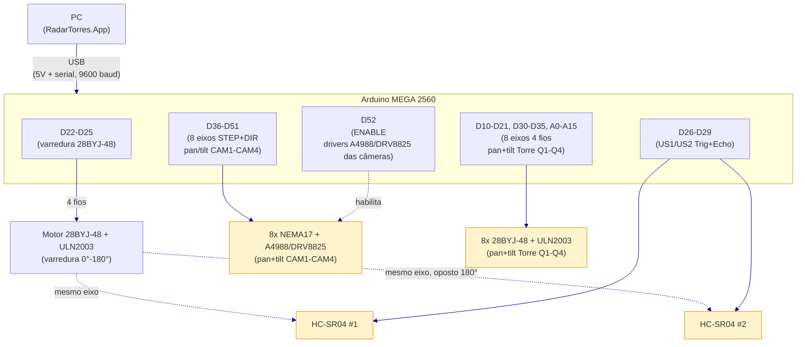

Funcionalidade: documenta o diagrama elétrico conceitual/funcional do hardware (pinagem, sensores, motores).

# Diagrama Elétrico (conceitual/funcional)

> Hardware real implementado em `Arduino/RadarTorres_Firmware/RadarTorres_Firmware.ino` (983 linhas,
> 13 motores de passo). Os componentes abaixo foram confirmados com o autor em 2026-09-19 (versão
> Uno/1 servo/1 sensor) e **substituídos** pela topologia real extraída diretamente do firmware em
> 2026-10-26 — ver nota de rastreabilidade no fim de cada seção. Este diagrama mostra **quais sinais
> ligam a quais pinos** — não é um esquemático elétrico completo (footprints/trilhas); para a
> montagem física, use uma ferramenta dedicada (Fritzing/KiCad).
>
> **`Arduino/ArduinoSimulation.ino` continua existindo** só para validar o protocolo serial sem
> hardware (não documentado aqui — é ferramenta de teste, não topologia de produção).
>
> O diagrama PlantUML (`Diagrama_Eletrico/Diagrama_Eletrico_RadarTorres.puml`) e o PNG exportado
> na mesma subpasta já foram regenerados (2026-10-27) a partir das tabelas abaixo, refletindo a
> topologia real.

## 1. Componentes

| Componente | Quantidade | Papel | Observação |
|---|---|---|---|
| Arduino MEGA 2560 | 1 | Microcontrolador (ATmega2560, lógica 5V) | Substituiu o Uno: 13 motores de passo não cabem nos ~20 pinos do Uno. Alimentado via USB pelo PC — mesma porta usada para o protocolo serial (`Software/Integracoes/COMUNICACAO_ARDUINO.md`) |
| Motor de passo 28BYJ-48 + driver ULN2003 | 1 | Varredura angular em zigue-zague (0°-180°) da torre central | 4 fios (IN1-IN4), controlado via biblioteca AccelStepper (modo FULL4WIRE) |
| Sensor ultrassônico HC-SR04 | 2 | Medem distância na posição angular atual, montados **opostos a 180° no mesmo eixo** de varredura — juntos cobrem os 360° a cada ciclo ida-e-volta | Lógica 5V — compatível direto com o MEGA, sem divisor de tensão. SENSOR=2 sempre reporta ângulo = ângulo do motor + 180° (mod 360) |
| Motor de passo NEMA17 + driver A4988/DRV8825 | 8 | Mira (pan + tilt) das 4 câmeras CAM1-CAM4 — 2 eixos por câmera, para centralizar o alvo detectado pela visão computacional do PC | STEP+DIR por eixo; enable próprio (D52), não mais compartilhado com as torres (ver nota de 2026 abaixo) |
| Motor de passo 28BYJ-48 + driver ULN2003 | 8 | Mira (pan + tilt, modelo 3D) das torres de decisão Q1-Q4 — 2 eixos por torre | 4 fios (IN1-IN4) por eixo, mesma convenção do motor de varredura central; gira a torre selecionada na direção do alvo (ver `TowerSelectionService`, lado PC). Velocidade assumida 15 RPM/eixo — ver `RadarTorres.App/NeuralEvolution/ParametrosTreinamento.cs` |

Total de eixos controlados (não bloqueante, via AccelStepper): **17** (1 varredura + 8 mira de câmeras + 8 mira de torres). Sem indicador luminoso dedicado: torre selecionada e evento de disparo são só registrados via protocolo serial (ACK/STATUS).

> **Atualização (eixo de tilt nas torres)**: as torres de decisão passaram de 1 motor NEMA17 (só
> pan) para 2 motores 28BYJ-48 por torre (pan + tilt) — mesmo modelo do motor de varredura central,
> trocado por ser mais barato/simples de controlar em pares por torre e por já ter precedente de uso
> validado no projeto. O TILT físico existe, mas o software de produção ainda não estima altura real
> do alvo (só o ambiente de treinamento neuroevolutivo tem essa informação, como experimento opcional
> — eixo Z); por isso o PC manda sempre `TILT=0.0` por enquanto (ver `RadarTorres.App/Models/Tower.cs`,
> `TiltAngleDegrees`). Mudança registrada aqui por não ter sido compilada/testada em hardware real —
> confira a pinagem (seção 2.4) antes de montar.

## 2. Pinagem (confirmada no firmware — `RadarTorres_Firmware.ino`, bloco "PINAGEM (MEGA 2560)")

### 2.1 Varredura central (28BYJ-48 / ULN2003)

| Sinal | Pino MEGA 2560 |
|---|---|
| IN1 | D22 |
| IN2 | D23 |
| IN3 | D24 |
| IN4 | D25 |

### 2.2 Sensores ultrassônicos (HC-SR04 x2)

| Sinal | Pino MEGA 2560 |
|---|---|
| US1 — Trig | D26 |
| US1 — Echo | D27 |
| US2 — Trig | D28 |
| US2 — Echo | D29 |

### 2.3 Motores de mira das câmeras (NEMA17 + A4988/DRV8825, 8 eixos)

Enable dos 8 drivers de câmera: **D52** (ativo em LOW). As torres (seção 2.4) não usam mais este
pino — 28BYJ-48/ULN2003 não tem linha de enable compartilhada como os drivers STEP+DIR.

| Eixo | STEP | DIR |
|---|---|---|
| CAM1 — Pan | D36 | D37 |
| CAM1 — Tilt | D38 | D39 |
| CAM2 — Pan | D40 | D41 |
| CAM2 — Tilt | D42 | D43 |
| CAM3 — Pan | D44 | D45 |
| CAM3 — Tilt | D46 | D47 |
| CAM4 — Pan | D48 | D49 |
| CAM4 — Tilt | D50 | D51 |

### 2.4 Motores de mira das torres (28BYJ-48 + ULN2003, 8 eixos — pan + tilt)

D2-D9 (antigo STEP+DIR das torres, modelo anterior) ficaram livres. A nova fiação usa 4 fios
(IN1-IN4) por eixo — 32 pinos no total para os 8 eixos — ocupando os digitais livres do Mega
(D10-D21, D30-D35) e, para as torres Q3/Q4, os pinos analógicos A0-A15 usados como digitais (uso
padrão no Mega 2560 quando os pinos digitais acabam).

| Eixo | IN1 | IN2 | IN3 | IN4 |
|---|---|---|---|---|
| Torre Q1 — Pan | D10 | D11 | D12 | D13 |
| Torre Q1 — Tilt | D14 | D15 | D16 | D17 |
| Torre Q2 — Pan | D18 | D19 | D20 | D21 |
| Torre Q2 — Tilt | D30 | D31 | D32 | D33 |
| Torre Q3 — Pan | A0 | A1 | A2 | A3 |
| Torre Q3 — Tilt | A4 | A5 | A6 | A7 |
| Torre Q4 — Pan | A8 | A9 | A10 | A11 |
| Torre Q4 — Tilt | A12 | A13 | A14 | A15 |

D34, D35 e D53 ficam livres/sobressalentes (não usados por nenhum componente desta revisão).

> **A confirmar**: o firmware não declara explicitamente um pino de alimentação dedicado para os
> drivers (VMOT dos A4988/DRV8825, tipicamente 8-35V externo, separado dos 5V lógicos do MEGA) nem a
> fiação física VCC/GND de cada HC-SR04/driver — só os pinos de sinal (STEP/DIR/TRIG/ECHO/ENABLE)
> estão no `.ino`. A topologia de alimentação (quantas fontes externas, distribuição de GND comum)
> não está no firmware e precisa ser definida/validada na montagem física.

## 3. Diagrama

Legenda: azul = sinal/dados digital. Blocos em amarelo (motores NEMA17 e sensores US1/US2) têm
alimentação (VMOT dos drivers, VCC dos HC-SR04) **não detalhada no firmware** — ver nota na seção
2.4. Fonte PlantUML: [`Diagrama_Eletrico_RadarTorres.puml`](Diagrama_Eletrico/Diagrama_Eletrico_RadarTorres.puml),
já regenerada (2026-10-27) para esta topologia.

## 4. Protocolo serial — mensagens novas (ver `Software/Integracoes/COMUNICACAO_ARDUINO.md` para o protocolo base)

O firmware real estende o protocolo textual já documentado (`TIPO;CHAVE=VALOR`, 9600 baud,
terminador `\n`):

| Direção | Mensagem | Descrição |
|---|---|---|
| Arduino → PC | `USONIC;SENSOR=<1\|2>;ANGLE=<0-360>;DIST=<cm>` | Leitura de um dos 2 ultrassônicos, associada ao ângulo do motor de varredura no instante da leitura |
| PC → Arduino | `COLOR;STATE=VERDE\|AMARELO\|VERMELHO` | Estado operacional do semáforo de segurança (máquina de estados de 3 níveis; distinto de `MODE;DETECTION\|AUTO`) |
| PC → Arduino | `CAM;ID=<1-4>;X=<px>;Y=<px>;Z=<cm>` | Deslocamento do alvo (X: +direita, Y: +abaixo) e distância estimada para a câmera CAM`<ID>` |
| PC → Arduino | `CALIB;CAM=<1-4>;PASSOS_POR_PX_PAN=<float>;PASSOS_POR_PX_TILT=<float>` | Ajusta em runtime a calibração pixel→passo de uma câmera |
| PC → Arduino | `AIM;TOWER=<1-4>;ANGLE=<0.0-360.0>;TILT=<-90.0-90.0>` | Gira os eixos pan (convenção de bússola, 0°=Norte, sentido horário) e tilt (0°=nível) da torre indicada. `TILT` é opcional (ausente = 0°); o PC atual sempre manda 0° (sem detecção de altura real do alvo em produção) |
| PC → Arduino | `FIRE;TOWER=<id>;TARGET=<id>` (reaproveitada) | Sinaliza o evento de disparo (sem LED) — só aceito com `COLOR;STATE=VERMELHO` e alvo estável |
| PC → Arduino | `GENOMA;RESET` / `GENOMA;INDICE=<0-81>;VALOR=<float>` / `GENOMA;COMMIT` | Carrega os 82 pesos/viés da rede neural embutida (mesma ordem de `RedeNeural.cs`, lado PC) |
| PC → Arduino | `REDE;ENTRADAS=<d>;<mesmo_quad>;<quad_adj>;<angulo>;<vel>;<tempo_deteccao>;<fator_camada>` | Pede o cálculo da rede embutida para 7 entradas |
| Arduino → PC | `STATUS;REDE_AJUSTE=<float>;REDE_CONFIANCA=<float>` | Resposta a `REDE;ENTRADAS` — **somente diagnóstico**, nunca aciona atuador algum (invariante de segurança explícita no firmware) |

A máquina de estados (VERDE/AMARELO/VERMELHO) e a rede neural embutida (7 entradas → 8 ocultos → 2
saídas, 82 genes, ativação tanh) espelham, respectivamente, o `Requisito 4` e
`src/RadarTorres.App/NeuralEvolution/RedeNeural.cs` do lado PC — ver
`Rede_Neural/Arquitetura/CONTROLADOR_NEUROEVOLUTIVO.md` para o funcionamento da
rede.

## 5. Observações

- **Alimentação dos motores de passo**: os drivers A4988/DRV8825 (12 ao todo: 8 de câmera + 4 de
  torre) tipicamente exigem VMOT externo (8-35V) separado da lógica 5V do MEGA — o firmware não
  especifica fonte/distribuição; **a confirmar** na montagem física.
- **Alimentação do 28BYJ-48**: motores de passo unipolares desse tipo normalmente toleram 5V direto
  do driver ULN2003, mas correntes de pico ao mover + os 2 HC-SR04 simultâneos podem exigir fonte
  externa para não picar o 5V do MEGA via USB (mesmo cuidado que já existia na versão com servo).
- **Echo dos HC-SR04 em 5V**: compatível direto com a lógica 5V do MEGA 2560, sem divisor de tensão.
- **Microstepping**: `CAM_MICROPASSOS` e `TORRE_MICROPASSOS` estão fixados em 16 no firmware,
  mas dependem do jumper físico MS1/MS2/MS3 de cada driver A4988/DRV8825 — **a confirmar**
  configuração física antes de usar em produção (comentário explícito no `.ino`).
- **Passos por volta do 28BYJ-48**: `SWEEP_STEPS_POR_VOLTA = 2048` é valor de referência para
  gearbox ~64:1 — **a confirmar** no motor real (seção "CALIBRAÇÃO" do `.ino`).
- **Calibração pixel→passo das câmeras**: valores iniciais (`camPassosPorPixelPan/Tilt = 2.0`) são
  placeholder — devem ser medidos na prática e podem ser ajustados em runtime via `CALIB` sem
  regravar o firmware.
- **Disparo sem LED**: sem indicador luminoso dedicado — `FIRE` só é aceito (ACK/`STATUS;DISPARO=OK`)
  em `COLOR;STATE=VERMELHO` com alvo estável; fora disso, recusado por `ERROR`.

## Ver também

- [[COMUNICACAO_ARDUINO]] — protocolo serial base que trafega entre o PC e este hardware.
- [[Diagrama_de_Implantacao]] — topologia física PC ↔ Arduino em nível mais alto.
- [[ALGORITMO_SELECAO_TORRE]] — lógica de seleção de torre (lado PC) que envia `AIM`/`FIRE`.
- [[CONTROLADOR_NEUROEVOLUTIVO]] — explicação da rede neural espelhada no Arduino (`GENOMA`/`REDE`).
