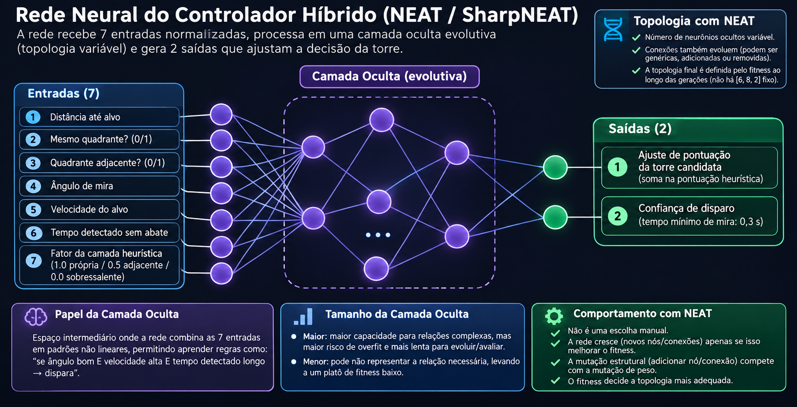
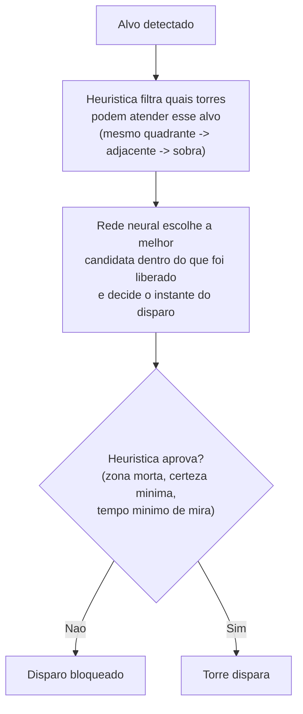
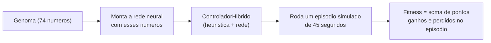
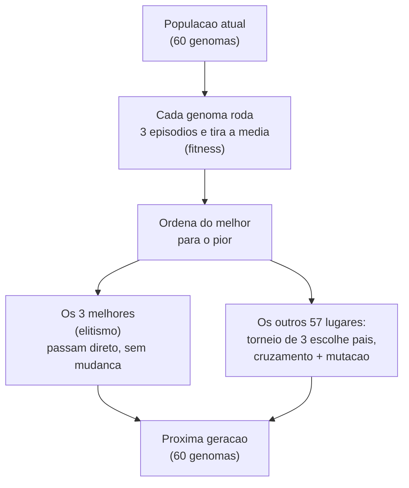
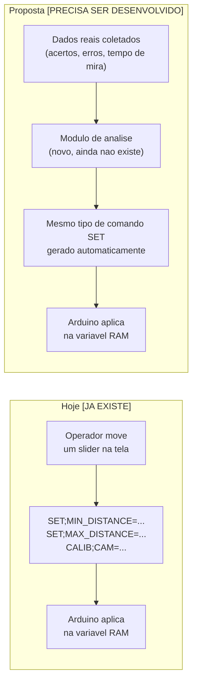

Funcionalidade: documenta o controlador híbrido heurística+rede neural evoluída (arquitetura,
treino, parâmetros) — referência técnica e explicação acessível para leitores não técnicos.

# Controlador Neuroevolutivo (Heurística + Rede Neural)

> Consolida `CONTROLADOR_NEUROEVOLUTIVO.md` (referência técnica, atual) e
> `Como_a_IA_funciona_no_RadarTorres.md` (explicação acessível) em um único documento. **Aviso de
> defasagem, sinalizado para revisão manual:** o Anexo (Parte 1 e Parte 3, a partir da seção A)
> descreve a arquitetura **anterior à migração para NEAT/SharpNEAT** — rede feedforward fixa de
> 6 entradas, 1 camada de 8 neurônios, 74 números, e um protocolo serial `GENOMA;INDICE=<0-73>`
> baseado nesse vetor plano. A Parte 1 técnica abaixo (seções 1-7) já reflete a arquitetura NEAT
> atual (7 entradas, topologia evolutiva, genoma em grafo `.net`). Os números/protocolo do Anexo
> **não foram atualizados** nesta consolidação — nenhum conteúdo foi inventado ou corrigido, só
> preservado como estava, com esta marcação explícita para quem for revisar/atualizar depois.

Documentação técnica do controlador híbrido que combina a heurística em camadas de seleção de
torre (ver [[ALGORITMO_SELECAO_TORRE]]) com uma rede neural evoluída por **NEAT** (via SharpNEAT).
Código-fonte em `src/RadarTorres.App/NeuralEvolution/`.

## 0. Problemática / motivação

A heurística pura de seleção de torre (ver [[ALGORITMO_SELECAO_TORRE]]) decide por regras fixas:
torre do próprio quadrante primeiro, depois adjacente, depois sobressalente; dentro da camada, a
mais próxima do alvo. É previsível e auditável, mas simplista: não leva em conta, por exemplo, que
um alvo rápido se aproximando num ângulo ruim pode valer mais a pena entregar a uma torre
levemente mais distante, mas melhor posicionada; ou que o instante ideal de disparo depende de
mais do que só "a certeza de detecção passou do limiar" — varia com velocidade do alvo, distância
à base e quanto tempo já se observa aquele alvo.

Um sistema puramente baseado em regras manuais para cobrir esses casos cresceria em se/então até
virar difícil de manter e de justificar no TCC. A alternativa oposta — uma rede neural de ponta a
ponta decidindo tudo sozinha — resolveria o ajuste fino, mas criaria uma caixa-preta sem
garantias: nada impediria a rede de aprender a escolher uma torre ocupada ou ignorar a cooperação
entre quadrantes, e não haveria como explicar a decisão a uma banca.

A solução adotada é o controlador **híbrido**: a heurística continua no comando das decisões que
não podem falhar (nunca escolher torre ocupada, nunca ignorar cooperação entre quadrantes,
respeitar o tempo mínimo de mira), e a rede neural — evoluída, não treinada por backpropagation,
para que o processo de aprendizado também seja auditável — entra só para *ajustar* a pontuação
dentro do que a heurística já aceitou como válido, e para decidir o instante exato do disparo
dentro da janela que a heurística permite. Em caso de dúvida ou de rede não treinada/incompatível,
o sistema sempre pode cair de volta para a heurística pura (seção 4.3) — nunca fica sem decisão.

### 0.1 Torres: formato físico, alcance e regras de disparo

Para quem lê este documento sem contexto do restante do projeto, seguem os dados concretos do
"mundo" em que o controlador decide — número de torres, alcance e critérios de disparo, com a
fonte exata de cada valor.

**Quantidade e posição.** 4 torres de decisão fixas, uma por quadrante (Q1-Q4), em posição fixa
durante toda a operação — não se deslocam, só giram. Configuração padrão (`appsettings.json`,
`Towers`): Torre 1 em `(1.75, 1.75)` m, Torre 2 em `(-1.75, 1.75)` m, Torre 3 em `(-1.75, -1.75)`
m, Torre 4 em `(1.75, -1.75)` m — um quadrado de 3,5 m de lado centrado na base. Configurável por
instalação.

**Formato físico (hardware real, `Projeto_Fisico/Eletronica/Diagrama_Eletrico.md`).** Cada torre
de decisão tem **1 grau de liberdade** (pan — giro horizontal), motor de passo NEMA17 + driver
A4988/DRV8825, sem eixo de elevação (tilt) — modelo 2D. É distinta das 4 câmeras CAM1-CAM4, que
têm 2 eixos cada (pan + tilt) só para centralizar visualmente o alvo detectado, e também distinta
da torre central de varredura (motor 28BYJ-48 + 2 sensores ultrassônicos HC-SR04 opostos a 180°,
cobrindo 360° a cada ciclo). O acionamento é **demonstrativo**: laser de baixa potência, LED ou
simulação em software — nunca armamento real (ver README, seção "Objetivo do sistema"). Não há
indicador luminoso dedicado no hardware atual: o evento de disparo só é registrado via protocolo
serial (`FIRE;TOWER=;TARGET=`, ACK/`STATUS`).

**Alcance de detecção/engajamento.** Uma torre só considera um alvo "visível" para fins de
seleção/engajamento dentro de `AlcanceMiraMetros` — valor de fábrica **2,5 m**
(`ConfiguracoesAplicativo.AlcanceMiraMetros`), ajustável em Configurações entre **0,5 m**
(`AlcanceMiraMinimoMetros`) e **10 m** (`AlcanceMiraMaximoMetros`, "acima disso nenhuma câmera do
projeto detecta com confiabilidade" — comentário no código). Esse é o mesmo raio usado pelo anel
visual do radar e pelo teto de distância do modo de simulação sem Arduino. Cada câmera tem campo
de visão horizontal de 60° (`VisionSettings.CameraFovHorizontalGraus`).

**Alcance de disparo.** Não existe um alcance de disparo diferente do alcance de
detecção/engajamento — a mesma distância acima (`AlcanceMiraMetros`) delimita até onde uma torre
consegue se engajar e, portanto, disparar. `FireControlService.Authorize`
(`src/RadarTorres.App/Services/FireControlService.cs`, lido linha a linha nesta revisão) exige: o
alvo estar ativo, o modo do sistema ser "Disparar", o alvo **não** estar em zona morta ativa, a
certeza de detecção acima do limiar mínimo (ver abaixo), e a torre ter linha de tiro livre para
aquele alvo (`Target.EngagingTowers`) — **a distância até a base não é critério dentro de
`Authorize`**. `RadarSettings.MinSafetyDistanceMeters` = **1,5 m** existe e é usado em dois outros
lugares — como raio do anel de segurança desenhado no radar (`MainViewModel`) e como base do
cálculo de "alvo urgente" na regra de priorização por urgência da seleção de torre
(`TowerSelectionService`, seção 7.2 de [[ALGORITMO_SELECAO_TORRE]]: urgente = distância ≤ 1,5× esse
valor) — mas, pela leitura atual do código, não bloqueia o disparo em si; a documentação
`ALGORITMO_SELECAO_TORRE.md` (seção 5) descreve esse bloqueio por distância como regra vigente e
não foi possível, nesta revisão, confirmar se ele foi deslocado para outro ponto do fluxo ou se a
doc está desatualizada — sinalizado aqui como incerteza, não como fato.

**Confiança mínima para disparo.** `LimiarConfiancaDisparoPercentual`, valor de fábrica **70%**
(`ConfiguracoesAplicativo.LimiarConfiancaDisparoPercentual`), piso absoluto **40%**
(`ConfiancaMinimaDisparoPercentual` — o usuário não consegue baixar mais que isso na tela). É a
mesma certeza que alimenta a entrada 6 da rede ("tempo detectado sem abate", seção 3) por via
indireta: a certeza de detecção de um alvo sobe com o tempo de observação até cruzar esse limiar;
só então o disparo passa a ser sequer cogitado. No ambiente de treinamento o equivalente é
`ParametrosTreinamento.LimiarConfiancaDisparoFracao` = 0,70 (fração), com piso
`LimiarConfiancaMinimaFracao` = 0,40 — mesmos números, em fração em vez de percentual.

**Erro de disparo.** Mesmo autorizado, um disparo pode errar — a probabilidade cresce
exponencialmente com a velocidade do alvo: `p_erro = 1 − e^(−0,35 · velocidade)`
(`CalculadoraErroDisparo`). Na prática: alvo parado ≈ 0% de erro; 1 m/s ≈ 30%; 2,5 m/s (máxima
velocidade simulada no treinamento) ≈ 59%. É por isso que existe a regra de "ajuda de torre
adjacente": acima de `VelocidadeRapidaMetrosPorSegundo` = **1,2 m/s** (mesmo limiar que classifica
um alvo como perigo "Alto" em `ClassificadorPerigoAlvo`), uma segunda torre de quadrante
adjacente, a até 2 m do alvo, também passa a engajá-lo — dois disparos reduzem a chance de o alvo
escapar de um erro isolado.

**Tempo mínimo de mira.** Mesmo com certeza suficiente e dentro do alcance, uma torre recém
comprometida com um alvo precisa de pelo menos `TempoMinimoDeMiraSegundos` = **0,3 s** antes de
poder disparar (`ControladorHibrido.TempoMinimoDeMiraSegundos`, veto inegociável — vale tanto no
modo híbrido quanto na heurística pura). Só depois desse piso a rede neural (ou, sem rede, a
heurística) decide o instante exato.

**Alvos (para contraste).** No ambiente simulado, um alvo nasce na borda de um mundo circular de
raio `RaioMundoMetros` = 10 m (padrão de treinamento), com velocidade entre
`VelocidadeMinimaAlvoMetrosPorSegundo` = 0,5 m/s e `VelocidadeMaximaAlvoMetrosPorSegundo` = 2,5
m/s, e uma "certeza" de detecção que começa entre 0,20 e 0,50 e sobe entre 0,08 e 0,25 por segundo
de observação (seção 5.1). No sistema real, o timeout de um alvo sem leitura nova é
`RadarSettings.TargetTimeoutMs` = 5000 ms, com taxa de atualização do radar de `RefreshRateMs` =
150 ms.

## 1. Visão geral

O objetivo deste módulo é refinar a escolha de torre e a decisão do instante de disparo além do
que a heurística pura (menor distância) consegue — sem substituí-la. A heurística continua
decidindo a **camada** de candidatas (torre do próprio quadrante → adjacente → sobressalente, ver
[[ALGORITMO_SELECAO_TORRE]] seção 4) e garante que a decisão nunca seja absurda (nunca escolhe
torre ocupada, nunca ignora a cooperação entre quadrantes). Dentro da camada escolhida, uma rede
neural evoluída por NEAT ajusta a pontuação das candidatas e decide o instante exato do disparo.

O treinamento ocorre num **ambiente simulado** próprio (`AmbienteTreinamento`), separado do
sistema em produção, e o resultado (um genoma NEAT, isto é, um grafo de nós e conexões) é
exportado no formato `.net` do SharpNEAT e embutido no executável para ser usado em tempo real por
`TowerSelectionService`.

Framework de terceiros (SharpNEAT) para a evolução/topologia, mas a função de fitness, o ambiente
de simulação e a combinação heurística+rede continuam código próprio do projeto — substituiu uma
implementação 100% própria anterior (rede feedforward de topologia fixa + algoritmo genético
escrito à mão, ainda presentes no repositório como `RedeNeural.cs` e `AlgoritmoGenetico.cs`, porém
não mais usados no fluxo de treinamento/produção; é essa implementação anterior que o Anexo deste
documento, abaixo, descreve).

## 2. Classes principais

| Classe/arquivo | Responsabilidade |
|---|---|
| `RedeNeat.cs` | Adaptador fino sobre a rede do SharpNEAT (`IBlackBox<double>`): expõe `Ativar(entradas)` com a mesma assinatura da antiga rede fixa, cuidando da convenção de bias (nó de índice 0) e do reset entre ativações (necessário porque o NEAT pode gerar redes cíclicas, com estado interno). |
| `TreinadorNeat.cs` | Comanda a evolução pelo SharpNEAT: configura o experimento (população, nº de espécies, elitismo, teto de complexidade, probabilidade de mutação estrutural), roda `EvoluirGeracao` e decodifica o genoma campeão (`Decodificar`) numa `RedeNeat` pronta para uso. |
| `ControladorHibrido.cs` | Combina heurística + rede: monta o vetor de entradas, pontua candidatas (`Pontuar`) e decide o instante de disparo (`DecidirDisparo`). É a MESMA classe usada tanto no ambiente de treinamento quanto (via os métodos estáticos `ConstruirEntradas`/`Pontuar`) em produção por `TowerSelectionService`. |
| `AmbienteTreinamento.cs` | Mundo 2D de simulação: torres fixas (mesmas posições do `appsettings.json`), alvos nascendo na borda e avançando até a base. Função de fitness usada pelo NEAT (`ExecutarEpisodioRapido`/`AvaliarFitness`). |
| `EstadoEpisodio.cs` | Estado mutável de um episódio em andamento (torres, alvos, relógio, estatísticas). |
| `TorreTreinamento.cs` / `AlvoTreinamento.cs` | Modelos de torre e alvo exclusivos do ambiente de treinamento (não são `Tower`/`Target` do domínio real). |
| `ParametrosTreinamento.cs` | Parâmetros ajustáveis de um episódio (raio do mundo, velocidades, recompensas/penalidades, tamanho de população, parâmetros de mutação estrutural etc.), expostos na tela de treinamento. |
| `EpisodioResultado.cs` | Resumo de um episódio: fitness total, alvos abatidos/escapados, tiros errados. |
| `ExtratorDeRegras.cs` | Aproxima, por análise de sensibilidade (variação de cada entrada em torno de um ponto de referência), frases em português descrevendo tendências aprendidas pela rede — não é extração exata, é uma leitura qualitativa para acompanhar o treinamento. |

## 3. Arquitetura da rede



Desde a migração para **SharpNEAT** (`RedeNeat.cs`, `TreinadorNeat.cs`), não existe mais
arquitetura fixa de camadas — só entrada e saída são contrato fixo, definidas em
`ControladorHibrido.QuantidadeEntradas`/`QuantidadeSaidas`:

- **7 entradas** (`ConstruirEntradas`): distância normalizada até o alvo, indicador de mesmo
  quadrante, indicador de quadrante adjacente, ângulo de mira normalizado, velocidade do alvo
  normalizada, tempo detectado sem abate (normalizado), fator da camada heurística (1.0 = própria,
  0.5 = adjacente, 0.0 = sobressalente).
- **Camada oculta evolutiva**: quantidade de neurônios ocultos e quais conexões existem (inclusive
  pulando camadas) são resultado da evolução por NEAT, não parâmetro de entrada — cresce ou
  encolhe geração a geração conforme o que melhora o fitness. Não há mais número fixo de neurônios
  nem genoma de tamanho previsível (o genoma agora é um grafo, não um vetor de pesos).
- **2 saídas**: ajuste de pontuação da torre candidata, e confiança de disparo.

`RedeNeat` expõe a caixa-preta do SharpNEAT com a mesma assinatura de `Ativar(entradas)` da antiga
rede fixa, para que `ControladorHibrido`, `ExtratorDeRegras` e `TowerSelectionService` não
precisem conhecer a API do framework. Internamente há um nó de bias (índice 0, sempre 1,0) somado
às 7 entradas reais — convenção do SharpNEAT, tratada só dentro de `RedeNeat`.

## 4. Como o controlador híbrido combina heurística + rede

### 4.1 Seleção de torre (`ControladorHibrido.SelecionarTorre` / `Pontuar`)

A pontuação final de uma torre candidata é:

```
pontuação = pontuação_heurística + ajuste_rede_neural
pontuação_heurística = (1 - distância_normalizada) + fator_camada
ajuste_rede_neural = rede.Ativar(entradas)[0]
```

Ou seja, a rede neural não decide do zero: ela **ajusta** uma pontuação heurística de base (quanto
mais perto e quanto "melhor" a camada, maior). Essa é a mesma combinação usada tanto no ambiente
de treinamento (`AmbienteTreinamento`/`ControladorHibrido.SelecionarTorre`) quanto em produção
(`TowerSelectionService.EscolherMelhorCandidata`, via os métodos estáticos
`ConstruirEntradas`/`Pontuar`).

### 4.2 Decisão de disparo (`ControladorHibrido.DecidirDisparo`)

A heurística impõe um limite inegociável: tempo mínimo de mira de 0,3 s
(`TempoMinimoDeMiraSegundos`) desde que a torre foi comprometida com o alvo. Passado esse tempo, a
rede decide o instante exato — a segunda saída da rede (`confiançaDisparo`) autoriza o disparo
quando é maior que zero. A distância até o alvo **não** é critério dentro desse método;
fora-de-zona-morta e certeza mínima são checados por quem chama (no treinamento,
`AmbienteTreinamento.DecidirDisparos`; em produção, `FireControlService`/regra de autorização).

### 4.3 Em produção (`TowerSelectionService`)

`TowerSelectionService` usa a rede treinada quando ela está disponível
(`IControladorTreinadoProvider.Rede` não nulo); caso contrário, cai para a heurística pura de
menor distância — comentário no código afirma que esse fallback é "idêntico ao que a rede produz
quando o genoma embutido é o zerado de fábrica". A margem de empate para a regra de anti-oscilação
(seção 7.1 de [[ALGORITMO_SELECAO_TORRE]]) muda conforme há ou não rede: 0,3 m de distância sem
rede, ou um valor de pontuação equivalente com rede.

## 5. Treinamento

### 5.1 Episódio de treinamento (`AmbienteTreinamento`)

Cada episódio simula um mundo circular de raio configurável (`RaioMundoMetros`, padrão 10 m) com
as mesmas posições de torre do `appsettings.json` (ou um layout padrão de 4 torres, uma por
quadrante, se não houver configuração — usado nos testes automatizados). Alvos nascem em pontos
aleatórios da borda e avançam em direção à base com um pequeno desvio angular (até ±30°), com
velocidade sorteada entre `VelocidadeMinimaAlvoMetrosPorSegundo` e
`VelocidadeMaximaAlvoMetrosPorSegundo`.

Cada alvo também tem uma "certeza" de detecção que começa baixa (`CertezaBase`, sorteada entre
0,20 e 0,50) e sobe com o tempo de observação (`TaxaCrescimentoCertezaPorSegundo`, sorteada entre
0,08 e 0,25 por segundo) — simula a câmera "confirmando" o alvo ao longo de vários quadros. Só pode
haver disparo quando essa certeza supera `LimiarConfiancaDisparoFracao` (padrão 0,70).

A cada passo de simulação (`Avancar`, `dt` = 0,2 s no modo rápido): possível nascimento de alvo,
movimento, penalidade de proximidade (ver abaixo), tratamento de alvos que chegaram à base (fuga),
seleção de torre para alvos ainda sem torre comprometida, e decisão de disparo.

**Fitness** (`EstadoEpisodio.FitnessAcumulado`) é incrementado/decrementado por:
- `+RecompensaAbate` (padrão 10,0) por alvo abatido, com bônus proporcional à distância da base no
  momento do abate (incentiva abater longe, não esperar o alvo se aproximar).
- `-PenalidadeEscape` (padrão 8,0) por alvo que chega à base sem ser abatido.
- `-PenalidadePerdaPonto` (padrão 3,0), aplicada uma única vez por alvo, quando ele cruza
  `DistanciaPerdaPontoMetros` (padrão 0,5 m) mesmo sem chegar a escapar de fato — penaliza deixar o
  alvo se aproximar demais antes de decidir.

Tiros errados (`TirosErrados`) contam por chance probabilística crescente com a velocidade do alvo
(`CalculadoraErroDisparo`), mesma regra usada no sistema real — não são penalizados diretamente no
fitness além de não gerarem a recompensa de abate.

Uma regra adicional de "ajuda de torre adjacente" dispara um segundo canhão (de um quadrante
adjacente, a até 2 m do alvo) quando o alvo está acima de `VelocidadeRapidaMetrosPorSegundo`
(padrão 1,2 m/s) — mesma regra 6 citada em commits recentes do projeto ("torre nunca solta alvo
por erro de tiro e ajuda de torre adjacente em alvo rápido").

### 5.2 Evolução por NEAT (`TreinadorNeat`)

- População padrão de 60 indivíduos, divididos em 6 espécies (`SpeciesCount`) — mecanismo central
  do NEAT, sem equivalente no algoritmo genético anterior: protege inovações estruturais recentes
  (nós/conexões novas) da competição direta com genomas já otimizados, dando tempo para elas serem
  ajustadas antes de serem eliminadas.
- Diferente da arquitetura fixa anterior, o NEAT parte de redes MÍNIMAS (só entradas ligadas às
  saídas) e vai acrescentando neurônios e conexões ao longo das gerações — a quantidade de
  neurônios ocultos do campeão é **resultado** da evolução (`NeuroniosOcultosDoCampeao`), não
  parâmetro escolhido.
- A cada geração, todos os indivíduos são avaliados em paralelo (`DegreeOfParallelism`, padrão:
  todos os núcleos) pela função de fitness fornecida.
- **Elitismo** (`ElitismProportion`, padrão 5%): fração dos melhores de cada espécie preservada
  sem alteração.
- Mutação ESTRUTURAL (`AddNodeMutationProbability`, padrão 1%) soma-se à mutação de pesos e às
  mutações de adicionar/remover conexão — é o knob que não existia antes, porque a topologia era
  fixa.
- **Regulação de complexidade** (`AbsoluteComplexityRegulationStrategy`, teto padrão de 60
  conexões): enquanto a rede tiver menos conexões que o teto, o NEAT pode crescer
  ("complexificando"); ao ultrapassar, entra em modo de "simplificando" — sem isso a topologia
  cresceria indefinidamente e cada avaliação (múltiplos episódios por indivíduo) ficaria
  progressivamente mais cara sem ganho de fitness correspondente.

Testes automatizados (`tests/RadarTorres.Tests/RedeNeatTests.cs`) cobrem a `RedeNeat`
isoladamente: determinismo da ativação para a mesma entrada/genoma, saídas sempre dentro de
`[-1, 1]` (saturação do `tanh`), convenção de bias, e erro ao construir com contagem de
entradas/saídas incompatível com a caixa-preta do SharpNEAT. `TreinadorNeatTests.cs` cobre o
treinador: que o melhor fitness não regride entre gerações (elitismo) e a numeração de gerações
(`EvoluirGeracao` — a primeira chamada apenas cria/avalia a população inicial, numerada geração 0
pelo próprio framework).

### 5.3 Avaliação com múltiplas seeds (`AvaliarFitness`)

Por padrão o fitness de um genoma é a **média de 3 episódios** (`EpisodiosPorAvaliacao`) com seeds
diferentes, mas as MESMAS seeds para todos os indivíduos de uma geração — comentário no código
explica que um único episódio é "barulhento demais" (nascimento, velocidade e certeza dos alvos
são todos sorteados), e sem múltiplos episódios o ruído de ambiente passaria a dominar sobre a
diferença real de qualidade entre genomas, degradando a seleção por torneio e até o elitismo a um
sorteio.

### 5.4 Exportação e embutimento no app

O genoma do melhor indivíduo é exportado pela tela "Treinamento do Controlador"
(`TreinamentoControladorViewModel.ExportarMelhorGenoma`) no formato `.net` do próprio SharpNEAT
(lista de nós + conexões, não mais um vetor plano de pesos). Esse arquivo é embutido como
`EmbeddedResource` (`rede-controlador.net`) e carregado em tempo de execução por
`ControladorTreinadoProvider` (`src/RadarTorres.App/Services/ControladorTreinadoProvider.cs`),
usando o leitor do próprio SharpNEAT (`NetFile.Load`), que expõe a `RedeNeat` pronta
(`IControladorTreinadoProvider.Rede`) para quem precisar. A rede embutida com contagem de
entradas/saídas incompatível com a versão atual do código (ex.: embutida antes de
`ControladorHibrido.QuantidadeEntradas` mudar) é rejeitada no carregamento, não trava o app. Se
nenhuma rede válida estiver embutida (instalação nova, nunca treinada, ou incompatível), `Rede` é
`null` e o sistema cai para a heurística pura (ver seção 4.3).

Esse genoma embutido também é enviado ao Arduino, mas **apenas para fins de
diagnóstico/auditoria** (`IRedeEmbutidaSincronizadorService` — comandos `GENOMA;*` e
`REDE;ENTRADAS=` do protocolo serial, ver [[COMUNICACAO_ARDUINO]]). O comentário na interface é
explícito: essa sincronização "nunca participa da seleção de torre nem da autorização de disparo,
que continuam decididas inteiramente pelo app". **Nota de defasagem**: o Anexo (Parte 3) descreve
esses mesmos comandos `GENOMA;*`/`REDE;ENTRADAS=` ainda em termos do vetor plano de 74 números da
arquitetura pré-NEAT — não confirmado nesta consolidação se o protocolo/firmware já foram
adaptados para o genoma em grafo do SharpNEAT.

## 6. Persistência (SQLite)

Três tabelas dedicadas registram o progresso de um treinamento em andamento (todas descritas em
[[BANCO_DE_DADOS]]):

### `historico_treinamento_geracoes`
Uma linha por **geração** (do melhor indivíduo daquela geração): melhor fitness, fitness médio,
alvos abatidos/escapados. É um **buffer circular de 300 linhas** —
`SqliteHistoricoTreinamentoRepository.Registrar` descarta a linha de `ID` mais antigo ao inserir a
301ª. Alimenta o gráfico/tabela de evolução recente na tela "Treinamento do Controlador"
(`TreinamentoControladorViewModel`).

### `marcos_fitness_treinamento`
Um marco a cada bloco de 500 gerações: fitness médio do bloco e o melhor fitness já visto dentro
dele. Sem limite de linhas (volume baixo, um marco a cada 500 gerações). Alimenta o painel
"Estatísticas de Treinamento" — exclusivo do Administrador (`EstatisticasTreinamentoViewModel`),
focado em tendência de longo prazo sem o ruído geração a geração.

### `instantaneos_comportamento_melhor_gene`
Um retrato completo do melhor genoma a cada 1.000 gerações: fitness, abatidos/escapados/tiros
errados, taxas derivadas (acerto = abatidos/(abatidos+tiros errados); cobertura =
abatidos/(abatidos+escapados)), e o grafo do genoma NEAT inteiro serializado no formato `.net` do
SharpNEAT, guardado em texto na coluna `GenomaJson` — para poder recarregar e reproduzir exatamente
aquele comportamento depois (o nome da coluna é legado da representação anterior, vetor de pesos
em JSON; o conteúdo hoje é o `.net`, não mais JSON). Sem limite de linhas; nunca sobrescrito.
Propósito explícito (comentário no modelo `InstantaneoComportamentoMelhorGene`): permitir estudar,
marco a marco, se a evolução do treinamento é real ou apenas oscilação de ruído.

Todas as três são somente-inserção (sem Update, exceto pela limpeza do buffer circular da
primeira).

## 7. Incertezas / não confirmado nesta leitura

- O valor exato de corte "margem de empate" usado por `TowerSelectionService` quando há rede
  treinada (`MargemEmpatePontuacaoRede`) não foi lido em detalhe — apenas confirmado que existe e
  é diferente do valor sem rede.
- Seção 0.1: `ALGORITMO_SELECAO_TORRE.md` (seção 5) descreve um bloqueio de disparo por
  `distância < MinSafetyDistanceMeters` dentro da autorização de acionamento, mas a leitura linha
  a linha de `FireControlService.Authorize` feita nesta revisão não encontrou esse critério ali —
  só zona morta, certeza mínima, modo do sistema e linha de tiro livre. Não foi possível confirmar
  se a checagem de distância mínima foi movida para outro ponto do fluxo (ex.: antes de
  `Authorize` ser chamado) ou se a doc do algoritmo está desatualizada.
- A frequência/gatilho exato de quando `TreinamentoControladorViewModel` decide registrar um marco
  de 500/1.000 gerações (`RegistrarInstantaneoDeComportamentoSeCompletouBloco` e equivalente para
  `marcos_fitness_treinamento`) não foi inspecionado linha a linha — a descrição acima vem dos
  comentários em `BANCO_DE_DADOS.md` e nos próprios modelos.
- Ver também a nota de defasagem no topo deste documento sobre o Anexo (Parte 1/3) ainda descrever
  a arquitetura pré-NEAT.

## Ver também

- [[ALGORITMO_SELECAO_TORRE]] — heurística em camadas que o controlador híbrido refina; seção 4
  descreve onde a rede neural entra no fluxo de seleção.
- [[ARQUITETURA_SISTEMA]] — camadas do sistema e onde `TowerSelectionService`/`ControladorTreinadoProvider` se encaixam.
- [[COMUNICACAO_ARDUINO]] — protocolo `GENOMA;*`/`REDE;ENTRADAS=` usado para auditoria/diagnóstico do genoma embutido no firmware.

---

# Anexo — Explicação acessível (como a IA funciona, em linguagem não técnica)

> **Aviso de defasagem (ver topo do documento):** as seções A.1 a A.9 abaixo descrevem a
> arquitetura **anterior à migração para NEAT** (rede fixa de 6 entradas, 1 camada de 8 neurônios,
> 74 números, algoritmo genético escrito à mão) — correta historicamente, mas os números
> específicos não correspondem mais à rede NEAT em produção (seções 1-7 acima). Preservada como
> estava no documento original, sem correção, para revisão manual.

Este anexo explica, em linguagem acessível, como funciona o controlador "inteligente" das torres
do RadarTorres: o que é heurística, o que é rede neural, como as duas se combinam, o que é
"fitness" (pontuação de treino), como o sistema ganha e perde pontos, se existe um teto/piso de
pontuação, se genomas são descartados, e se é possível chegar a um controlador "perfeito".

## A.1 Visão geral: duas peças, não uma só

Quando as pessoas ouvem "IA", costumam imaginar só a rede neural. No RadarTorres a decisão de qual
torre atira em qual alvo, e quando atirar, nunca é tomada só pela rede neural — ela é sempre tomada
por **duas peças trabalhando juntas**, dentro da mesma classe (`ControladorHibrido`):

1. **Heurística** — um conjunto de regras fixas, escritas à mão, que nunca mudam sozinhas.
2. **Rede neural** — um "ajuste fino" aprendido por treino evolutivo (explicado abaixo), que decide
   dentro do espaço que a heurística já liberou.



A ideia central: a rede neural **nunca decide sozinha**. Ela só ajusta a decisão dentro de um
espaço que a heurística já considerou seguro. Se a rede "pedir" algo fora desse espaço (atirar numa
zona morta, atirar sem certeza suficiente, escolher uma torre ocupada), a heurística barra. No pior
caso, o sistema volta a se comportar como a heurística pura — nunca faz algo arbitrário.

## A.2 O que é a heurística (a parte "regra fixa")

A heurística decide em cascata, por camadas de prioridade, qual torre pode atender um alvo:

1. Primeiro, olha só as torres livres do **mesmo quadrante** do alvo.
2. Se nenhuma estiver livre, olha torres de **quadrante vizinho**.
3. Se nenhuma das anteriores, usa **qualquer torre livre restante** — nenhum alvo fica sem
   cobertura.

Depois disso, ela ainda aplica regras de segurança que a rede nunca pode desrespeitar:

- **Tempo mínimo de mira**: a torre precisa ficar pelo menos 0,3 segundo "olhando" pro alvo antes
  de poder disparar.
- **Certeza mínima de identificação**: o disparo só é liberado se a certeza de que aquilo é
  realmente um alvo for de pelo menos 70% (padrão; configurável, nunca abaixo de 40%).
- **Zona morta**: quadrantes marcados como zona morta nunca recebem disparo, não importa o que a
  rede "ache".

## A.3 O que é a rede neural (a parte "aprendida") — arquitetura pré-NEAT

É uma rede neural pequena, criada do zero no código (sem biblioteca de IA pronta):

- **6 entradas**: distância normalizada até o alvo, se é do mesmo quadrante, se é de quadrante
  vizinho, ângulo de mira, velocidade do alvo, e a camada heurística vigente.
- **1 camada escondida de 8 neurônios.**
- **2 saídas**: um ajuste de pontuação (para desempatar entre torres candidatas) e uma confiança de
  disparo (decide o instante exato de atirar).
- Ao todo, **74 números** (pesos + vieses) definem completamente essa rede.

Diferente da maioria das IAs que você já deve ter ouvido falar (que aprendem por
"retropropagação"/gradiente), essa rede **não aprende sozinha observando erros em tempo real**. Os
74 números dela são decididos por um **algoritmo genético** — é aí que entram fitness, pontuação,
gerações e genomas.

## A.4 O que é "fitness"

**Fitness é a pontuação de um episódio simulado de treino.** Cada "genoma" (um conjunto de 74
números/pesos para a rede) é testado controlando as torres durante um episódio simulado de **45
segundos**, com alvos nascendo na borda de um círculo de 10 metros de raio e avançando em direção à
base. O fitness é simplesmente a soma de pontos ganhos e perdidos ao longo desse episódio.



Importante: **cada genoma é testado em 3 episódios diferentes (sorteados de formas diferentes) e o
fitness final é a média dos 3**. Isso existe porque um único episódio é "barulhento" demais — o
mesmo genoma podia cair num cenário fácil ou difícil só por sorte, o que faria o algoritmo genético
escolher por sorte, não por mérito.

## A.5 Como o sistema ganha pontos

Só existe uma forma de ganhar pontos: **abater um alvo antes que ele chegue na base.**

```
pontos_ganhos = 10 × (0,7 + 0,3 × bonus_distancia)
```

Onde `bonus_distancia` é o quão longe da base o alvo estava quando foi abatido (0 = bem em cima da
base, 1 = na borda do mundo, a 10 metros). Ou seja:

- Abater um alvo **bem longe da base** vale **10 pontos** (o máximo por abate).
- Abater um alvo **bem perto da base** vale **7 pontos** (o mínimo por abate que ainda conta como
  sucesso).

Isso existe de propósito: recompensar abater cedo (sobra mais margem de erro) mais do que abater em
cima da hora.

## A.6 Como o sistema perde pontos

Existem duas formas de perder pontos, e elas são diferentes:

| Situação | Quando acontece | Quanto perde |
|---|---|---|
| **Alvo chegou perto demais da base** (aviso) | Alvo cruza 0,5 m de distância da base, mesmo sem ter "escapado" de verdade ainda | **−3 pontos**, uma única vez por alvo |
| **Alvo escapou de verdade** | Alvo cruza 0,4 m de distância da base (bem em cima dela) sem ter sido abatido | **−8 pontos**, e a torre que estava de olho nele é liberada |

Repare que os dois podem acontecer com o **mesmo alvo**: primeiro ele cruza os 0,5 m (−3), e só
depois, se continuar sem ser abatido, cruza os 0,4 m e escapa de vez (−8) — nesse caso o alvo
custou **−11 pontos** sozinho. Por isso vale mais a pena abater cedo.

Há também um terceiro evento que **não tira pontos diretamente, mas também não dá pontos**: o
**tiro errado**. Mesmo quando a torre está autorizada a atirar, existe uma chance de errar,
crescente com a velocidade do alvo:

```
chance_de_erro = 1 − e^(−0,35 × velocidade)
```

Na prática: alvo parado ≈ 0% de chance de errar; alvo a 1 m/s ≈ 30%; alvo na velocidade máxima
simulada (2,5 m/s) ≈ 59%. Um tiro errado não soma nem subtrai pontos diretamente, mas "desperdiça" a
chance de ganhar os 7–10 pontos daquele abate — então, indiretamente, empurra o genoma a não deixar
o alvo chegar rápido demais sem reação.

## A.7 Existe uma pontuação máxima ou mínima?

**Não existe um teto nem um piso fixos — o fitness é uma soma aberta, não uma nota de 0 a 100.**

Isso é diferente de provas escolares ou de jogos com pontuação limitada. Aqui, quanto mais alvos
nascerem e forem abatidos num episódio de 45 segundos, mais alto o fitness pode subir; quanto mais
alvos escaparem, mais fundo ele pode cair. Não existe um valor "perfeito" documentado no código.

Para dar uma noção de escala (não são limites oficiais, são só contas aproximadas a partir das
regras acima):

- Em 45 segundos, com alvos nascendo a cada 1,5–4 segundos, **cabem entre ~11 e ~30 alvos** no
  episódio (limitado a no máximo 5 "vivos" ao mesmo tempo).
- Um episódio **muito bom** (quase todos abatidos longe da base) poderia somar algo perto de **+200
  a +300 pontos**.
- Um episódio **muito ruim** (quase todos escapando) poderia ficar perto de **−200 a −300 pontos**.

Esses números são só para dar intuição de grandeza — o que importa de verdade é a **comparação
relativa** entre genomas dentro da mesma geração (todos enfrentam os mesmos 3 cenários sorteados),
não um valor absoluto de referência.

## A.8 Existe descarte de genoma?

**Sim, mas não é um descarte explícito tipo "lista negra" — é seleção natural por geração.**

A cada geração, a população tem sempre **60 genomas**. O que acontece:



- Os **3 melhores genomas** (elitismo) são copiados sem alteração para a próxima geração — isso
  garante que a geração **nunca piora** em relação à anterior.
- Os outros **57 lugares** são preenchidos por filhos: dois "pais" são escolhidos por **torneio de
  3** (sorteiam-se 3 genomas da população, vence o de maior fitness entre os 3), seus genes são
  misturados (**cada um dos 74 números vem do pai ou da mãe, 50% de chance cada**), e depois cada
  gene tem **8% de chance** de sofrer uma pequena mutação aleatória.
- Genomas ruins não são explicitamente apagados ou proibidos — eles simplesmente **têm muito menos
  chance de vencer um torneio e virar pai**, então, geração após geração, as características deles
  tendem a desaparecer da população. É assim que a evolução "descarta" o que não funciona: por
  baixa probabilidade de reprodução, não por exclusão manual.
- A população inteira é **recriada a cada geração** (exceto os 3 elites) — não existe um "arquivo"
  guardando todo genoma já testado. O que fica salvo no banco de dados são só resumos periódicos: o
  fitness médio/melhor a cada bloco de gerações, e um "retrato" do melhor genoma de cada marco
  (contagem de abates, fugas, tiros errados e o próprio genoma em texto).

## A.9 É possível chegar a um sistema "ideal"?

**Não, e isso é esperado — por três motivos, todos de projeto, não falha:**

1. **O ambiente é sorteado, não fixo.** Onde o alvo nasce, sua velocidade, a rapidez com que a
   certeza dele sobe, tudo isso é sorteado a cada alvo. Mesmo o "melhor genoma possível" vai, às
   vezes, pegar um cenário difícil (alvo rápido, nascendo perto) e vai perder pontos nele — não por
   erro do genoma, por azar do cenário.
2. **O erro de disparo é probabilístico.** Mesmo um disparo perfeitamente autorizado, no momento
   certo, pode errar — a chance cresce com a velocidade do alvo e nunca chega a 0%. Não existe
   genoma que acerte 100% dos disparos contra alvos rápidos; a própria regra do jogo (a mesma usada
   em produção) impede isso.
3. **Algoritmo genético não garante "o melhor de todos os mundos".** Diferente de um problema de
   matemática com resposta única, o algoritmo genético só garante **melhora ao longo do tempo**
   (por causa do elitismo) — ele pode ficar "preso" numa solução boa, mas não a melhor teoricamente
   possível (isso se chama **ótimo local**, bem documentado na literatura de algoritmos genéticos).
   Rodar mais gerações tende a melhorar, mas não existe garantia matemática de chegar ao máximo
   absoluto.

Além disso, vale lembrar o ponto da seção A.1: a rede neural só ajusta dentro do que a heurística já
permite. Então o "teto" de qualidade do sistema também depende da própria heurística ser boa — se
ela tiver uma regra ruim, a rede não consegue compensar isso sozinha, só otimizar dentro da regra
que existe.

**Na prática**, o que o treinamento faz é: convergir, geração após geração, para um comportamento
cada vez melhor e mais consistente diante da variação do ambiente — não para um valor fixo de
"sistema perfeito", mas para um platô de bom desempenho, com melhora cada vez mais lenta conforme
mais gerações passam (comportamento típico de algoritmos evolutivos).

---

## Anexo — Parte B: como a IA poderia ajustar variáveis do Arduino durante a execução (PROPOSTA)

**Aviso importante antes de começar**: tudo que vem a partir daqui, até a seção B.8, é uma
**proposta de arquitetura — nada disso está implementado hoje**. A Parte A (seções A.1 a A.9)
descreve um mecanismo que já existe e já roda no projeto: o treino evolutivo da rede neural do
`ControladorHibrido`. Esta Parte B descreve um mecanismo **diferente e ainda não construído**: o
controlador desktop observando o comportamento real do sistema em operação e ajustando, por comando
serial, variáveis de controle que hoje moram fisicamente no firmware do Arduino — sem jamais
reescrever ou regravar esse firmware. Cada afirmação abaixo está marcada como **[JÁ EXISTE]**,
**[PRECISA SER DESENVOLVIDO]** ou **[PROPOSTA/OPÇÃO]**, para não deixar dúvida sobre o que já roda
no projeto e o que é desenho de solução. Esta parte é independente da migração NEAT — descreve uma
camada nova (ajuste de parâmetros de firmware), não a rede de decisão em si.

### B.1 Duas coisas diferentes usam a palavra "IA" neste projeto — não confundir

A Parte A inteira trata de um processo **offline**: o algoritmo de treino roda numa tela de
treinamento, dentro de episódios **simulados**, e o resultado é embutido no instalador do
aplicativo antes mesmo de o sistema ser ligado em campo. Esse resultado não é enviado ao Arduino
como "variável de controle", e não muda sozinho durante a execução real — ele só muda quando alguém
treina uma geração nova e embute o resultado manualmente.

O que esta Parte B descreve é outra coisa: um mecanismo **online**, rodando durante a operação real
do sistema (não em simulação), que observaria dados coletados de verdade (acertos, erros, tempo de
travamento de mira etc.) e, a partir deles, ajustaria **parâmetros do firmware do Arduino** — não os
pesos/genoma da rede de decisão, que continuam vivendo inteiramente no app desktop e nunca saem de
lá. São dois sistemas de ajuste completamente distintos:

| | Parte A — treino evolutivo (**JÁ EXISTE**) | Parte B — ajuste de variáveis do Arduino (**PROPOSTA**) |
|---|---|---|
| O que muda | Os pesos/genoma da rede do `ControladorHibrido` | Parâmetros numéricos do firmware (ex.: tolerância de mira, nº de leituras estáveis) |
| Onde roda o ajuste | Só no app desktop, offline, em simulação | App desktop observando dados reais + Arduino aplicando o valor |
| Quando acontece | Antes de o sistema entrar em operação (treino manual) | Durante a operação real, continuamente |
| Onde o resultado vive | Embutido no app (genoma exportado) | Em variáveis na memória RAM do Arduino (ou EEPROM, se implementado) |
| Risco de piorar o sistema físico real | Nenhum — testado só em simulação antes de embutir | Direto — qualquer ajuste ruim afeta o hardware físico imediatamente |

### B.2 O que já existe hoje na comunicação com o Arduino

Antes de propor qualquer coisa nova, veja o que o protocolo serial do RadarTorres já é capaz de
fazer hoje — documentado em [[COMUNICACAO_ARDUINO]] e implementado em
`src/RadarTorres.App/Services/SerialProtocolParser.cs`.

**[JÁ EXISTE]** Mensagens Arduino → PC: `TARGET;ID=;ANGLE=;DIST=` (leitura de alvo),
`STATUS;SYSTEM=` (estado do sistema), `ACK;CMD=` (confirmação de um comando recebido),
`ERROR;REASON=` (comando recusado, com o motivo).

**[JÁ EXISTE]** Mensagens PC → Arduino: `SYSTEM;ON|OFF`, `MODE;DETECTION|AUTO`,
`FIRE;TOWER=;TARGET=` (disparo), `AIM;TOWER=;ANGLE=` (mira manual), e — o mais importante pra este
documento — **já existem dois comandos que ajustam uma variável do firmware sem reescrever
código**:

```
SET;MIN_DISTANCE=<metros>
SET;MAX_DISTANCE=<metros>
```

**[JÁ EXISTE]** Esses dois comandos já estão com fiação completa ponta a ponta: a tela principal do
app (`MainViewModel.cs`) dispara `SerialProtocolParser.BuildSetMinDistance(...)` /
`BuildSetMaxDistance(...)` toda vez que o **operador humano** mexe no controle correspondente na
tela; o firmware de simulação (`ArduinoSimulation.ino`) recebe a mensagem, converte o texto para
número (`toFloat()`) e grava direto nas variáveis `minDistance`/`maxDistance`, sem precisar
regravar nada no Arduino. O firmware mais completo (`RadarTorres_Firmware.ino`) tem um exemplo ainda
mais próximo do que esta proposta precisa: o comando

```
CALIB;CAM=<1-4>;PASSOS_POR_PX_PAN=<float>;PASSOS_POR_PX_TILT=<float>
```

ajusta, em tempo real, a calibração pixel→passo de motor de uma câmera específica, guardada num
vetor `camPassosPorPixelPan[4]`/`camPassosPorPixelTilt[4]` que não é `const` — ou seja, o próprio
projeto já prova, com código real e funcional, que "ajustar uma variável de controle do Arduino via
serial, sem reescrever o firmware" é tecnicamente viável e já foi feito pelo menos duas vezes.

**[PRECISA SER DESENVOLVIDO]** O que falta, e é a lacuna central desta proposta: hoje **nada aciona
esses comandos automaticamente por decisão de um processo de análise** — só o dedo do operador na
tela. O código do `NeuralEvolution/` (toda a lógica de heurística + rede neural) não tem nenhuma
referência a `SerialProtocolParser` ou a qualquer envio de comando ao Arduino — ele decide seleção
de torre e instante de disparo inteiramente dentro do processo do app, e nunca escreve nada de volta
no hardware.



**[PRECISA SER DESENVOLVIDO]** Também não existe hoje: validação de faixa no firmware (o
`toFloat()` de `SET;MIN_DISTANCE` aceita qualquer número, mesmo um absurdo, sem checar limite
nenhum), persistência em EEPROM (nenhum dos dois arquivos `.ino` do projeto usa `EEPROM.h` — todo
ajuste feito hoje por `SET`/`CALIB` se perde se o Arduino for desligado ou resetado), e qualquer
tabela no banco de dados registrando esses ajustes (as tabelas que já existem no SQLite do projeto
— ver [[BANCO_DE_DADOS]] — não incluem nada sobre ajuste de variável de firmware).

### B.3 Por que a rede neural de decisão não pode simplesmente "virar" uma variável do Arduino

É importante deixar claro por que esta proposta NÃO é "mandar a rede de decisão pro Arduino": essa
rede já é pequena de propósito, mas mesmo assim ela decide **qual torre** atende cada alvo e
**quando** atirar — uma decisão lógica/estratégica, que precisa comparar várias torres candidatas
ao mesmo tempo, olhar outros alvos ativos, zonas mortas etc. O Arduino, no desenho atual do
protocolo, nunca recebe essa visão do mundo inteira — ele só recebe comandos já decididos
(`FIRE;TOWER=;TARGET=`, `AIM;TOWER=;ANGLE=`). Portar a rede pra rodar dentro do Arduino significaria
redesenhar o firmware inteiro para também enxergar todas as torres e todos os alvos
simultaneamente — mudança de escopo completamente diferente do que foi pedido aqui.

O que esta proposta ajusta não são pesos/genoma de rede neural, e sim **parâmetros nomeados e
isolados** que já existem (ou poderiam existir) no firmware, cada um controlando um aspecto físico
específico do comportamento: `TOLERANCIA_PX_X`/`TOLERANCIA_PX_Y` (quão perto do centro o alvo
precisa estar pra contar como "mirado"), `LEITURAS_ESTAVEIS_NECESSARIAS` (quantas leituras seguidas
dentro da tolerância antes de liberar o disparo), `camPassosPorPixelPan`/`Tilt` (calibração física
pixel→motor, já ajustável hoje via `CALIB`), `minDistance`/`maxDistance` (já ajustável hoje via
`SET`). São variáveis de **controle de malha física** (quão sensível, quão rápido, quão tolerante),
não decisões estratégicas — essas continuam sendo tomadas só pelo app, como hoje.

### B.4 Pipeline proposto, passo a passo

**[PROPOSTA]** — nenhuma destas etapas existe implementada hoje; é o desenho de como construiria.

**Como os dados coletados seriam processados.** O projeto já persiste, no SQLite, dados reais de
cada ação executada (`acoes_realizadas`: torre, objeto detectado, acerto ou erro, velocidade do
alvo — ver `Services/FireControlService.cs:RegistrarAcao`) e classificações de perigo por
velocidade (`classificacoes_alvo`). Um módulo novo (ex.: `Services/AjusteFirmwareService`,
seguindo o mesmo padrão de injeção de dependência e repositórios já usado no projeto) rodaria
periodicamente — por exemplo a cada N ações registradas, ou a cada intervalo de tempo fixo — e
calcularia métricas agregadas sobre uma janela recente: taxa de acerto por torre, taxa de acerto
por faixa de velocidade do alvo, e (campo novo, que precisaria ser acrescentado à tabela
`acoes_realizadas` ou a uma tabela nova) o tempo decorrido entre "torre selecionada" e "disparo
liberado" — uma medida direta de quão rápido o Arduino está considerando o alvo "travado".

**Como a IA decidiria quais variáveis ajustar.** **[PROPOSTA]** Não seria a rede de decisão do
`ControladorHibrido` decidindo isso — ela não tem essa responsabilidade hoje, e misturar as duas
coisas criaria uma dependência arriscada entre um processo testado em simulação e um processo que
mexe em hardware físico real. Em vez disso, a decisão seria uma **tabela de regras
determinísticas**, no mesmo espírito das heurísticas que já existem no projeto (cada regra isolada,
com limite numérico fixo, documentada e revertível):

| Métrica observada | Variável candidata | Direção do ajuste | Limite de segurança |
|---|---|---|---|
| Taxa de acerto caindo + tempo de travamento baixo | `TOLERANCIA_PX_X/Y` (deadband de mira) | Diminuir (exigir mira mais precisa) | Nunca abaixo de ~4 px (evita nunca travar) |
| Tempo de travamento alto demais (alvo escapando antes de travar) | `LEITURAS_ESTAVEIS_NECESSARIAS` | Diminuir (exigir menos confirmações) | Nunca abaixo de 2 (evita disparo por ruído) |
| Erro sistemático de mira numa câmera específica | `camPassosPorPixelPan/Tilt` daquela câmera | Corrigir proporcionalmente ao erro médio observado | Dentro de uma faixa física plausível da lente/motor |

Cada linha dessa tabela só dispara um ajuste se a métrica estiver fora da meta por **mais de um
período mínimo de estabilização** (mesmo princípio já usado na regra de anti-oscilação da seleção
de torre) — evita o sistema ficar "nervoso", mudando a variável a cada poucas ações.

**Como os novos valores seriam enviados e aplicados, sem mexer no código.** **[JÁ EXISTE o
mecanismo, PRECISA SER DESENVOLVIDO quem o aciona]** O envio reaproveitaria exatamente o canal e o
formato que `SET;MIN_DISTANCE`/`CALIB` já usam hoje: o módulo de ajuste chamaria
`ISerialCommunicationService.SendCommandAsync(...)` com uma string de comando no mesmo formato
`COMANDO;CAMPO=valor`, sem precisar de nenhuma mudança na camada de transporte serial já existente.
Dois comandos novos precisariam ser adicionados ao protocolo e ao firmware (hoje não existem):

```
SET;DEADBAND_PX=<valor>
SET;LEITURAS_ESTAVEIS=<valor>
```

seguindo o mesmo padrão de parsing que `SET;MIN_DISTANCE` já usa — comparar o início da linha
recebida com `line.startsWith("SET;DEADBAND_PX=")`, extrair o valor com `.toFloat()`/`.toInt()`, e
atribuir à variável correspondente (que precisaria deixar de ser `const` no firmware, exatamente
como já aconteceu com `camPassosPorPixelPan/Tilt` quando viraram ajustáveis por `CALIB`).

**Como o Arduino receberia, validaria e usaria os valores.** **[PRECISA SER DESENVOLVIDO — gap de
segurança real hoje]** Aqui está a diferença mais importante que esta proposta precisa corrigir em
relação ao que já existe: hoje, `SET;MIN_DISTANCE`/`SET;MAX_DISTANCE` **não validam nada** — um
valor absurdo (negativo, gigantesco, texto malformado que vira `0.0` silenciosamente) é aceito e
aplicado direto. Para um ajuste gerado automaticamente (sem um operador humano olhando o número
antes de confirmar), isso deixa de ser aceitável. O firmware precisaria, para cada `SET` novo,
aplicar um `constrain()` (função nativa do Arduino) para cada valor recebido, dentro de uma faixa
física segura definida em `const` no próprio firmware — por exemplo:

```cpp
else if (linha.startsWith("SET;DEADBAND_PX=")) {
  int valor = linha.substring(String("SET;DEADBAND_PX=").length()).toInt();
  valor = constrain(valor, DEADBAND_PX_MINIMO, DEADBAND_PX_MAXIMO);
  TOLERANCIA_PX_X = valor;
  TOLERANCIA_PX_Y = valor;
  Serial.println("ACK;CMD=" + linha + ";APLICADO=" + String(valor));
}
```

Note o `;APLICADO=` acrescentado à resposta `ACK` — hoje o `ACK;CMD=...` só ecoa o comando
recebido, sem confirmar qual valor foi *de fato* aplicado depois do `constrain()`; para o app saber
se o firmware aceitou o valor exato ou ajustou para o limite de segurança, a resposta precisaria
carregar o valor final aplicado, não só repetir o comando enviado.

**Como o sistema avaliaria os resultados e decidiria se faz novo ajuste.** **[PROPOSTA]** Depois de
aplicado um ajuste, o módulo de análise entraria num modo de "observação": o próximo bloco de ações
(mesmo tamanho de janela usado para detectar o problema original) seria medido com o **novo**
valor, e a métrica (taxa de acerto, tempo de travamento) comparada com o período anterior ao
ajuste:

- Se a métrica **melhorou ou se manteve**: mantém o novo valor e continua monitorando normalmente —
  o ambiente real muda (luz, posição, desgaste mecânico), então o monitoramento nunca para de vez,
  só passa a comparar a partir do novo valor como referência.
- Se a métrica **piorou**: desfaz o ajuste automaticamente (volta ao valor anterior, que precisa
  ficar guardado — não só o valor novo), e registra o evento para o operador revisar depois. Essa
  política de **rollback automático** é o que torna o mecanismo seguro o bastante pra rodar sem
  supervisão constante: o pior caso de um ajuste ruim é um bloco de ações com desempenho pior, nunca
  uma degradação permanente.
- **Nunca mais de um ajuste por variável dentro do período mínimo de estabilização**, e **nunca duas
  variáveis ajustadas ao mesmo tempo** — isso isola a causa: se duas coisas mudassem junto e o
  resultado piorasse, não daria para saber qual delas foi a culpada.

### B.5 Exemplo prático, passo a passo

Cenário concreto, usando a variável `LEITURAS_ESTAVEIS_NECESSARIAS` (hoje fixa em `5`, conforme
`RadarTorres_Firmware.ino:163`) como exemplo:

1. **Coleta**: ao longo de uma tarde de operação, o sistema registra 80 disparos em
   `acoes_realizadas`. 30 deles foram contra alvos com velocidade "Alta"/"Crítica" (≥1,2 m/s, ver
   `ClassificadorPerigoAlvo`), e desses 30, apenas 14 acertaram (taxa de acerto de ~47%, bem abaixo
   da taxa geral de ~75% dos alvos lentos).
2. **Processamento**: o módulo de análise, rodando a cada 50 ações novas, calcula a taxa de acerto
   segmentada por velocidade e identifica que o problema está concentrado nos alvos rápidos — não é
   um problema geral de calibração de câmera (que afetaria todas as velocidades igualmente).
3. **Decisão de qual variável ajustar**: consultando a tabela de regras acima, a métrica "taxa de
   acerto baixa em alvo rápido" aponta para `LEITURAS_ESTAVEIS_NECESSARIAS` como candidata: exigir 5
   leituras estáveis seguidas antes de disparar pode ser tempo demais para um alvo que se move
   rápido — ele pode já ter saído da tolerância de novo antes de completar as 5 leituras. A regra
   propõe diminuir para 3, dentro do limite de segurança (nunca abaixo de 2).
4. **Envio**: o app monta o comando `SET;LEITURAS_ESTAVEIS=3` e envia pela mesma
   `ISerialCommunicationService` já usada hoje por `SET;MIN_DISTANCE`.
5. **Recepção no Arduino**: o firmware recebe a linha, `constrain()` o valor entre 2 e 5, atribui a
   `LEITURAS_ESTAVEIS_NECESSARIAS` (que passaria a ser uma variável `uint8_t`, não mais `const`), e
   responde `ACK;CMD=SET;LEITURAS_ESTAVEIS=3;APLICADO=3`.
6. **Avaliação**: nas próximas 50 ações contra alvos rápidos, a taxa de acerto sobe para ~68%. O
   módulo de análise registra a melhora e mantém o valor 3.
7. **Nova alteração?** O módulo continua monitorando; se, dias depois, a taxa cair de novo (por
   exemplo, por desgaste do motor de passo ou mudança de iluminação afetando a detecção), um novo
   ciclo de ajuste pode disparar — sempre respeitando o período mínimo de estabilização e nunca
   mexendo em mais de uma variável por vez.

### B.6 Requisitos técnicos para implementar isso com segurança

**[PROPOSTA — lista do que precisaria existir]**

1. **Validação em duas camadas**: no app (antes de enviar, igual ao `Math.Clamp` já usado em
   `ConfiguracoesAplicativo`) **e** no firmware (`constrain()` redundante — a comunicação serial
   pode corromper um valor em trânsito, então confiar só em quem enviou é frágil).
2. **Confirmação com valor aplicado**: `ACK` carregando o valor *efetivamente* gravado, não só o
   comando recebido.
3. **Rollback automático e histórico do valor anterior**: o app precisa guardar o valor de antes do
   ajuste para poder desfazer sozinho se o resultado piorar.
4. **Persistência opcional em EEPROM**: hoje nenhum ajuste sobrevive a um desligamento do Arduino
   (nenhum `.ino` do projeto usa `EEPROM.h`). Se os ajustes devem persistir entre reinícios, seria
   necessário `EEPROM.put()`/`EEPROM.get()` com um valor de fábrica de segurança caso a EEPROM
   esteja vazia/corrompida.
5. **Auditoria em banco de dados**: uma tabela nova (seguindo o padrão das tabelas SQLite já
   existentes — interface de repositório + implementação `Sqlite*Repository`), registrando cada
   ajuste: variável, valor anterior, valor novo, motivo (qual métrica disparou), timestamp, e o
   resultado da avaliação seguinte (melhorou/piorou/revertido).
6. **Override manual**: o operador sempre poderia travar uma variável específica (impedir que o
   ajuste automático mexa nela) e reverter manualmente a qualquer momento — mesmo princípio das
   heurísticas hoje desligáveis individualmente em `ConfiguracoesAplicativo`.
7. **Circuito de proteção (circuit breaker)**: se N ajustes seguidos de uma mesma variável piorarem
   o resultado, o ajuste automático daquela variável se desliga sozinho e alerta o operador — evita
   um ciclo de tentativa-e-erro infinito mexendo no hardware físico.
8. **Validação em simulação antes de campo**: qualquer comando `SET` novo precisa primeiro ser
   testado no firmware de simulação (`ArduinoSimulation.ino`) antes de ir para o firmware real —
   mesma cautela já discutida no artigo acadêmico do projeto sobre a diferença entre simulação e
   hardware físico.

### B.7 Formas diferentes de implementar — comparação e recomendação

**[PROPOSTA]** Existem pelo menos três abordagens possíveis para "quem decide o novo valor da
variável":

**Opção 1 — Regra determinística de ajuste incremental** (a descrita em B.4-B.5): uma tabela fixa
de métrica→variável→direção→limite, com passos pequenos e rollback automático. **Vantagens**:
simples, auditável, 100% previsível, fácil de testar e reverter, reaproveita exatamente o padrão
arquitetural que o projeto já usa (heurísticas determinísticas com limites rígidos, cada uma isolada
e desligável). **Recomendada para este projeto.**

**Opção 2 — Reaproveitar o algoritmo de treino já existente, treinando "genes de firmware" com
dados reais coletados em produção** (em vez de em simulação): mais alinhado com o "espírito" de IA
do projeto, mas tem um problema sério — o treino evolutivo testa dezenas de genomas por geração, e
alguns são necessariamente ruins (é assim que ele aprende, ver seção A.8); rodar genomas ruins
diretamente no hardware físico, em vez de em simulação, significa o sistema realmente disparando
errado contra alvos reais só para "aprender" que aquele genoma não presta. **Não recomendada para
uso direto em produção.** No máximo, poderia rodar **offline**, sobre os dados já coletados e salvos
(sem tocar o hardware ao vivo), sugerindo um novo conjunto de valores que um humano revisa e aprova
manualmente antes de aplicar — um uso bem mais cauteloso do mesmo algoritmo que já existe.

**Opção 3 — Controlador PID clássico (proporcional-integral-derivativo) por variável**: adequado
para variáveis contínuas de malha fechada onde já existe uma medida de erro constante, como a
calibração de câmera (`camPassosPorPixelPan/Tilt`, comparando o erro de pixel observado frame a
frame) — ali um PID seria uma evolução natural do que o `CALIB` já permite hoje. **Não é adequado**
para variáveis discretas e de baixa frequência de atualização, como
`LEITURAS_ESTAVEIS_NECESSARIAS` (um PID não faz sentido para um contador de poucas unidades) — seria
over-engineering fora desse caso específico.

**Recomendação final**: Opção 1 (regra determinística incremental) como mecanismo geral para a
maioria das variáveis, complementada pela Opção 3 (PID) especificamente para a calibração de
câmera, onde o projeto já tem a infraestrutura mais madura (`CALIB`) e um sinal de erro contínuo
natural. A Opção 2 fica descartada para uso em tempo real no hardware físico, mas pode ser
reaproveitada como ferramenta de análise offline sobre dados já coletados, sempre com aprovação
humana antes de qualquer valor sugerido ser de fato aplicado.

### B.8 O que já existe vs. o que precisa ser desenvolvido — resumo

| Item | Status |
|---|---|
| Protocolo serial com comandos de ação (`FIRE`, `AIM`, `MODE`) | **Já existe** |
| Comando `SET;MIN_DISTANCE`/`MAX_DISTANCE` ajustando variável do firmware sem reflash | **Já existe** (acionado só por operador humano) |
| Comando `CALIB;CAM=...` ajustando calibração de câmera sem reflash | **Já existe** (acionado só por operador humano) |
| Validação de faixa no firmware para os `SET` já existentes | **Não existe** — gap de segurança real |
| Persistência (EEPROM) dos ajustes entre reinícios do Arduino | **Não existe** |
| Qualquer acionamento automático de `SET`/`CALIB` por análise de dados | **Não existe** |
| Coleta de dados reais de acerto/erro por ação (`acoes_realizadas`) | **Já existe** |
| Coleta de "tempo até travar mira" por ação | **Não existe** — precisaria ser acrescentada |
| Módulo de análise/decisão de qual variável ajustar | **Não existe — é a proposta central desta parte** |
| Novos comandos `SET;DEADBAND_PX=`/`SET;LEITURAS_ESTAVEIS=` | **Não existem** — propostos aqui |
| Tabela de auditoria de ajustes de variável de firmware | **Não existe** |
| Rollback automático / circuito de proteção | **Não existe** |

### B.9 Resumo rápido (Parte A + B)

| Pergunta | Resposta curta |
|---|---|
| O que é fitness? | Pontuação de um episódio simulado de 45s, média de 3 episódios por genoma |
| Como ganha ponto? | Abater um alvo: 7 a 10 pontos (mais pontos quanto mais longe da base) |
| Como perde ponto? | Alvo chega perto da base: −3 (uma vez); alvo escapa de vez: −8 |
| Tem pontuação máxima/mínima fixa? | Não — é soma aberta; só dá pra estimar faixas aproximadas |
| Genoma ruim é descartado? | Não é "apagado" — só tem pouca chance de virar pai na próxima geração |
| Dá pra chegar num sistema perfeito? | Não — ambiente sorteado, erro de disparo probabilístico, e o treino evolutivo não garante ótimo global |
| A rede neural ajusta variáveis do Arduino hoje? | **Não** — ela só decide seleção de torre/disparo dentro do app; nunca escreve no Arduino |
| Existe algum ajuste de variável do Arduino sem reflash hoje? | Sim — `SET;MIN_DISTANCE/MAX_DISTANCE` e `CALIB;CAM=...`, mas só acionados manualmente pelo operador |
| O ajuste automático proposto (Parte B) já está implementado? | **Não** — é uma proposta de arquitetura |

---

## Anexo — Parte C: rede neural embutida no firmware do Arduino (implementado, pré-NEAT)

### C.1 Dá pra rodar a rede neural dentro do controlador do Arduino?

Pergunta direta: **sim, dá pra rodar o *forward-pass* dessa rede (6→8→2, 74 números) dentro do
próprio Arduino — e isso foi implementado neste projeto.** Mas com uma condição de segurança que não
é negociável, explicada abaixo, porque é ela que torna essa mudança segura.

**Capacidade de hardware**: o controlador real do projeto (ver
`Arduino/RadarTorres_Firmware/RadarTorres_Firmware.ino`) usa um **Arduino Mega 2560** (256 KB de
memória de programa, 8 KB de RAM). Os 74 números da rede ocupam menos de 300 bytes, e calcular a
saída é só multiplicação e soma seguidas de uma função `tanh` — tarefa trivial para esse hardware,
mesmo sem ponto flutuante nativo. O tamanho da rede nunca foi o problema.

**O problema de verdade — e como foi resolvido**: a rede neural é só metade da decisão
(`ControladorHibrido`); a outra metade é a heurística de segurança (zona morta, torres ocupadas,
certeza mínima, tempo de mira), que hoje só existe no aplicativo desktop, olhando o estado de
*todos* os alvos e *todas* as torres ao mesmo tempo — informação que nunca chegou ao Arduino, e que
seria arriscado duplicar ali. A solução implementada **não tenta portar a heurística** — ela embute
só o cálculo puro da rede neural no firmware, como uma peça **estritamente passiva**:

> **Invariante de segurança**: a função que calcula a saída da rede dentro do Arduino
> (`calcularSaidaRedeEmbutida`, em ambos os firmwares) **nunca chama, direta ou indiretamente,
> nenhuma função de atuação** — nenhum `digitalWrite`, nenhum `stepper.move`, nenhuma chamada a
> `solicitarDisparo()`. Ela só recebe números e devolve números pela porta serial. O pior caso
> possível de um bug nessa função é um número errado aparecer no console de eventos do app — **nunca**
> um motor se mover ou uma torre disparar sem autorização.

### C.2 O que foi implementado, concretamente

Dois comandos novos no protocolo serial (documentados também em [[COMUNICACAO_ARDUINO]]), seguindo
exatamente o mesmo formato `TIPO;CHAVE=VALOR;...` já usado por `SET`/`CALIB`:

```
PC -> Arduino:
  GENOMA;RESET
    Zera o buffer de carregamento de um novo genoma.
  GENOMA;INDICE=<0-73>;VALOR=<float>
    Envia UM peso/viés por vez (índice na mesma ordem de RedeNeural.cs do lado PC).
  GENOMA;COMMIT
    Só troca o genoma ativo se TODOS os 74 índices já tiverem chegado — senão,
    recusa com ERROR e mantém o genoma anterior em uso.
  REDE;ENTRADAS=<d>;<mesmo_quadrante>;<quadrante_adjacente>;<angulo>;<velocidade>;<fator_camada>
    Pede ao Arduino para calcular a saída da rede embutida com estas 6 entradas.

Arduino -> PC:
  ACK;CMD=GENOMA;INDICE=<n>             (um peso recebido)
  ACK;CMD=GENOMA;COMMIT;STATUS=OK       (genoma novo ativado)
  ERROR;REASON=GENOMA INCOMPLETO...     (commit recusado, genoma antigo mantido)
  STATUS;REDE_AJUSTE=<v>;REDE_CONFIANCA=<v>   (resultado do forward-pass pedido)
```

Por que **um peso por comando**, em vez de mandar os 74 de uma vez numa linha só: o buffer de
recepção serial do Arduino é pequeno, e uma linha gigante (74 números) é um risco desnecessário de
corrupção/perda de dados. Enviando um de cada vez, com `ACK` individual, qualquer peso que se perca
no caminho é detectado (o `GENOMA;COMMIT` recusa ativar um genoma incompleto) e pode ser reenviado
sozinho — sem precisar reenviar os outros 73.

**Duas camadas de validação** (a mesma preocupação levantada em B.6, agora aplicada): o Arduino
confere se o índice está entre 0 e 73 e aplica `constrain()` no valor recebido contra um teto de
sanidade — proteção contra corrupção de linha, não um limite de treino. O lado PC só manda o genoma
que já validou ter o tamanho certo (74), reaproveitando a mesma checagem que a rede já fazia na
construção (arquitetura pré-NEAT).

**Para que serve, já que não aciona nada**: diagnóstico e auditoria. O app pode enviar as mesmas 6
entradas que ele mesmo calculou para `ControladorHibrido.Pontuar`, pedir ao Arduino para calcular a
saída de forma **independente**, e comparar as duas respostas no console de eventos — uma forma de
confirmar que o genoma realmente chegou certo ao hardware (ex.: depois de uma atualização de
firmware ou de uma nova sincronização), sem depender de só "confiar" que o valor foi transmitido
corretamente. Pequenas diferenças (na faixa de milésimos) são esperadas e não indicam problema —
vêm de o PC calcular em `double` (64 bits) e o Arduino em `float` (32 bits); diferença grande (ex.:
sinal trocado ou ordem de grandeza diferente) indicaria um peso corrompido na transmissão ou uma
divergência de versão entre o firmware e o código do lado PC.

### C.3 O que mudou no código (na época da implementação pré-NEAT)

| Arquivo | Mudança |
|---|---|
| `Arduino/ArduinoSimulation.ino` | Comandos `GENOMA;*`/`REDE;ENTRADAS=` + `calcularSaidaRedeEmbutida` (testável sem hardware) |
| `Arduino/RadarTorres_Firmware/RadarTorres_Firmware.ino` | Mesma implementação, no firmware real |
| `src/RadarTorres.App/Services/SerialMessages.cs` | Novo tipo `RedeSaidaMessage` |
| `src/RadarTorres.App/Services/SerialProtocolParser.cs` | `BuildGenomaIndice`/`BuildGenomaCommit`/`BuildGenomaReset`/`BuildRedeEntradas` + parse de `STATUS;REDE_AJUSTE=...` |
| `src/RadarTorres.App/Services/IControladorTreinadoProvider.cs` | Expõe também o genoma plano (`double[]? Genoma`), não só a rede já construída |
| `src/RadarTorres.App/Services/IRedeEmbutidaSincronizadorService.cs` (novo) | Envia o genoma ativo ao Arduino e pede validação de entradas |
| `src/RadarTorres.App/ViewModels/MainViewModel.cs` | Comando para disparar a sincronização/validação manualmente; trata `RedeSaidaMessage` recebida |

**[PENDENTE à época]** O comando `MainViewModel.SincronizarRedeEmbutidaCommand` existia e
funcionava (chama `IRedeEmbutidaSincronizadorService.SincronizarGenomaAsync`), mas **não tinha sido
ligado a nenhum botão na tela** — não confirmado nesta consolidação se isso foi resolvido depois da
migração para NEAT, nem se o protocolo `GENOMA;*` foi adaptado para o genoma em grafo.

### C.4 O que continua igual (e por quê isso importa)

A seleção de torre e a autorização de disparo **continuam exatamente como antes** — só o app
decide, usando `ControladorHibrido`, e só o app manda `FIRE;TOWER=;TARGET=` depois de passar por
todas as checagens de `FireControlService.Authorize`. A rede embutida no Arduino não participa
dessa decisão em nada; ela existe só como instrumento de verificação. Essa é a diferença central
entre "a rede roda no Arduino" (verdadeiro, implementado) e "o Arduino decide sozinho" (falso —
continua tão longe disso quanto antes).
